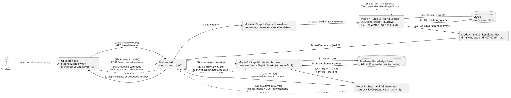

# Đặc tả Kỹ thuật Tính năng: Tìm kiếm Thông tin (Information Searching)

## 0. Tóm tắt Luồng Hoạt động (Dành cho Thuyết trình & Đồng bộ Liên nhóm FE / DB / AI-Host)

Tính năng Tìm kiếm Thông tin hoạt động hoàn toàn ở chế độ **chỉ đọc (Read-only)**, tách rời khỏi khung hội thoại xếp lịch. Ngay tại giao diện tìm kiếm (Bước 0), người dùng chủ động chọn 1 trong 2 chế độ để định tuyến thẳng đến quy trình xử lý chuyên biệt, không tốn chi phí gọi AI phân loại ý định:

```text
[INPUT TỪ NGƯỜI DÙNG]
Sinh viên chọn chế độ trên thanh Search (Step 0) + Nhập câu truy vấn tự nhiên + JWT Bearer Token
   |
   +---> [CHỐT CHẶN ĐIỀU HƯỚNG CHÉO]: Nếu phát hiện câu lệnh đặt/xếp lịch ("xếp cho mình 2 tiếng...")
   |        +--> Dừng tìm kiếm, trả thông báo nhắc bấm nút "Trợ lý AI" (redirect_target = "chat_home").
   |
   +---> [HƯỚNG 1: TRA CỨU LỊCH TRÌNH CÁ NHÂN] (GET /api/v1/search/events)
   |        |
   |        +--> Bước 1 (Query Optimizer - Tất định): Chuẩn hóa tiếng Việt không dấu/teencode,
   |        |    bung từ viết tắt môn học, quy đổi ngày tương đối sang mốc giờ +07:00.
   |        +--> Bước 2 (SQL Exact Filter - MySQL 8.0): Lọc cứng theo owner_id,
   |        |    deleted_at IS NULL, khoảng thời gian, loại sự kiện (kind) và phòng học.
   |        +--> Bước 3 (Cascaded 2-Tier Vector Search - Dừng tại Top-K, KHÔNG gọi LLM):
   |        |    - Tầng 1 (Core < 2ms): Nhúng vector 512 chiều kết hợp cụm khái niệm môn học
   |        |      (SEMANTIC_CONCEPT_CLUSTERS) + khớp từ vựng để tìm cả tên chính xác lẫn chủ đề rộng.
   |        |    - Tầng 2 (Neural Fallback): Chỉ kích hoạt mô hình đa ngữ chạy CPU khi Tầng 1
   |        |      trả về ít hơn N kết quả (do người dùng gõ từ đồng nghĩa lạ ngoài từ điển).
   |        +--> Bước 4 (Result Verifier): Hậu kiểm biên thời gian/loại sự kiện, chuẩn hóa +07:00.
   |        +--> [OUTPUT HƯỚNG 1]: Danh sách thẻ sự kiện khớp nhất (ISO 8601 +07:00, 0% bịa đặt).
   |
   +---> [HƯỚNG 2: HỎI ĐÁP TRI THỨC HỌC VỤ] (POST /api/v1/search/academic/ask)
            |
            +--> Bước 1-3 (Vector Retrieval - Kho chỉ mục mã hóa Fernet do Admin/DB nạp sẵn):
            |    Nhúng câu hỏi, quét kho quy chế/sổ tay sinh viên, lấy Top-K đoạn vượt ngưỡng điểm.
            |    (Nếu dưới ngưỡng -> dừng ngay, báo chưa có tài liệu, không gọi LLM).
            +--> Bước 4-6 (RAG Generation - Hàng đợi FIFO + Llama 3.1 trên vLLM, timeout 3s):
            |    Đóng gói ngữ cảnh vào System Prompt khóa cứng nguồn, sinh câu trả lời tiếng Việt.
            |    (Nếu vLLM bận/quá 3s -> Fallback trả trực tiếp trích đoạn gốc từ tài liệu).
            +--> [OUTPUT HƯỚNG 2]: Câu trả lời tổng hợp bám sát quy chế + Danh sách nguồn trích dẫn.
```

---

## 1. Sơ đồ Kiến trúc Luồng Xử lý (Pipeline Flow Diagram) & Kịch bản Luồng chạy



### Mô tả chi tiết các luồng kịch bản trên sơ đồ (theo số thứ tự mũi tên):

1. **Bước `1` (Thao tác đầu vào tại UI Search Tab):** Sinh viên mở tab **Tìm kiếm** (`search_home`), gạt chọn chế độ ở Bước 0 (**Tra cứu lịch cá nhân** hoặc **Hỏi đáp học vụ**) và nhập câu truy vấn vào thanh tìm kiếm.
2. **Nhánh `[2x: Misrouted Scheduling Command]` (Điều hướng chéo khi gõ nhầm câu lệnh xếp lịch vào ô Search):**
   * Nếu sinh viên gõ câu yêu cầu hành động xếp lịch (ví dụ: *"xếp cho mình 2 tiếng ôn thi chiều mai"*) vào thanh Search, hàm `is_scheduling_command` bắt được mẫu câu ngay tại đầu vào và trả về `redirect_target = "chat_home"`, `redirect_button_label = "Trợ lý AI"` kèm lời nhắc chuyển sang tab **Trợ lý AI**.
3. **Luồng Hướng 1 - Tra cứu Lịch trình Cá nhân (Mũi tên `2a -> 3a -> 4a -> 5a -> 6a -> 7a -> 8a -> 9`):**
   * **`[2a: Schedule mode]`:** Giao diện gửi `GET /api/v1/search/events?q=...` kèm JWT Token vào `Backend API`.
   * **`3a -> 4a` (Step 1 - Query Optimizer):** Hàm `optimize_search_query` chuẩn hóa teencode/không dấu, bung từ viết tắt học phần (`"xstk"` -> `"xác suất thống kê"`), tách bộ lọc cấu trúc (`window_start`, `window_end`, `kind`, `room_hint`) và từ khóa chủ đề `keywords`.
   * **`5a -> 6a` (Step 2 - SQL Read-Only Filter):** Hàm `execute_local_search` truy vấn bảng `events` và `courses` trong MySQL với điều kiện bắt buộc `owner_id == current_user.id` và `deleted_at IS NULL`.
   * **`[6a-1: Tier 1 Core Vector]` & `[6a-2: Tier 2 Neural Fallback]`:**
     * *Tầng 1 (Core):* Chấm điểm lai giữa độ khớp từ vựng (`lex_score`) và độ tương đồng vector khái niệm (`vec_score` dựa trên `SEMANTIC_CONCEPT_CLUSTERS` + `rag.embed`).
     * *Tầng 2 (Fallback):* Chỉ khi Tầng 1 trả về ít hơn `MIN_TIER1_RESULTS` (`< 1` kết quả) mà câu hỏi có từ khóa chuyên môn lạ chưa kịp cập nhật vào từ điển khái niệm, hệ thống mới gọi mô hình embedding đa ngữ dự phòng (`_compute_neural_fallback_scores`) để quét lại ứng viên.
   * **`7a -> 8a -> 9` (Step 3 - Result Verifier):** Hàm `verify_and_format_search_results` kiểm tra chéo biên thời gian, đổi múi giờ từ UTC sang `+07:00` và trả danh sách thẻ sự kiện về giao diện (tuyệt đối không gọi LLM).
4. **Luồng Hướng 2 - Hỏi đáp Tri thức Học vụ (Mũi tên `2b -> 3b -> 4b -> 5b -> 6b -> 7b -> 9`):**
   * **`[2b: Academic mode]`:** Giao diện gửi `POST /api/v1/search/academic/ask` vào `Backend API`.
   * **`3b -> 4b -> 5b` (Step 1-3 - Vector Retriever):** Câu hỏi sau khi chuẩn hóa được nhúng thành vector và quét trên kho chỉ mục mã hóa `Academic Knowledge Base` (`data/rag/academic_kb`) để lấy `top_k` đoạn văn bản có điểm tương đồng cao nhất.
   * **`[6b-2: empty/low score]` (Nhánh dừng sớm chống bịa đặt):** Nếu không có đoạn văn bản nào đạt ngưỡng `MIN_SCORE = 0.12`, hệ thống dừng ngay tại Bước 3, không gọi LLM và trả thông báo chưa có thông tin trong tài liệu học vụ.
   * **`[6b-1: score >= 0.12]` -> `[7b-1: normal]` (Step 4-6 - RAG Generation):** Đóng gói các đoạn trích dẫn vào prompt, đẩy qua hàng đợi tuần tự FIFO `broker` tới `Llama 3.1` trên `vLLM` (timeout `3.0s`) để sinh câu trả lời tiếng Việt kèm danh sách `citations`.
   * **`[7b-2: AI timeout/error]` (Nhánh Fallback khi AI bận):** Nếu `vLLM` quá hạn 3 giây hoặc mất kết nối, hệ thống ghi `AiErrorLog`, bật `fallback_mode = True` và trả trực tiếp nguyên văn các đoạn trích dẫn `citations` đã tìm được ở Bước 3 về cho sinh viên.

---

## 2. Hướng 1: Tra cứu Lịch trình Cá nhân (Hybrid SQL + Cascaded 2-Tier Vector Search)

### 2.1. Công nghệ & Module áp dụng
* **Bộ tối ưu hóa truy vấn tất định (`Query Optimizer`):** Khử dữ liệu nhạy cảm [`sanitize_prompt`](file:///C:/Users/heyto/projects/AI-assistant-project-team04/sourceCode/BE/services/privacy.py), chuẩn hóa tiếng Việt không dấu/teencode [`normalize_text`](file:///C:/Users/heyto/projects/AI-assistant-project-team04/sourceCode/BE/services/normalizer.py), từ điển viết tắt môn học `COURSE_ABBREVIATIONS` ([`services/search_engine.py`](file:///C:/Users/heyto/projects/AI-assistant-project-team04/sourceCode/BE/services/search_engine.py#L49-L85)) và bộ quy đổi ngày tương đối [`resolve_date_hint`](file:///C:/Users/heyto/projects/AI-assistant-project-team04/sourceCode/BE/services/temporal.py#L27-L103).
* **Truy vấn quan hệ chính xác:** SQLAlchemy 2.0 đồng bộ (`pymysql`) trên MySQL 8.0 qua [`active_events_stmt`](file:///C:/Users/heyto/projects/AI-assistant-project-team04/sourceCode/BE/database.py#L149-L169) và [`active_courses_stmt`](file:///C:/Users/heyto/projects/AI-assistant-project-team04/sourceCode/BE/database.py#L171-L181).
* **Kiến trúc Vector Search 2 tầng (Không gọi LLM):**
  * **Tầng 1 (Core Engine):** Bảng gom cụm khái niệm chương trình đào tạo `SEMANTIC_CONCEPT_CLUSTERS` (bao phủ 9 nhóm: Toán học, Lập trình/CS, Mạng/Hệ thống/Bảo mật, AI/Khoa học dữ liệu/CSDL, Vật lý/Khoa học tự nhiên, Ngoại ngữ, Lý luận chính trị/Đại cương, Giáo dục thể chất/Quốc phòng, Kỹ năng mềm/CLB) kết hợp hàm băm vector đơn vị 512 chiều [`rag.embed`](file:///C:/Users/heyto/projects/AI-assistant-project-team04/sourceCode/BE/services/rag.py#L28-L45).
  * **Tầng 2 (Neural Embedding Fallback):** Hàm [`_compute_neural_fallback_scores`](file:///C:/Users/heyto/projects/AI-assistant-project-team04/sourceCode/BE/services/search_engine.py#L353-L380) nạp lười (lazy-load) mô hình đa ngữ nhẹ trên CPU (`paraphrase-multilingual-MiniLM-L12-v2`) chỉ khi Tầng 1 trả về dưới `MIN_TIER1_RESULTS` kết quả.

### 2.2. Đặc tả Input chặt chẽ
* **Endpoint:** [`GET /api/v1/search/events`](file:///C:/Users/heyto/projects/AI-assistant-project-team04/sourceCode/BE/routers/search.py#L102-L166)
* **Xác thực bắt buộc:** Header `Authorization: Bearer <jwt_token>` (`HTTP 401` nếu thiếu hoặc không hợp lệ).
* **Tham số đầu vào (Query Parameters):**
  * `q` (`str`, mặc định `""`, tối đa `500` ký tự): Chuỗi tìm kiếm tự nhiên.
  * `kind` (`EventKind | None`, tùy chọn): Lọc cứng theo loại sự kiện (`CLASS`, `EXAM`, `DEADLINE`, `EVENT`, `TASK`).
  * `start_from`, `end_until` (`datetime | None`, tùy chọn, ISO 8601): Giới hạn khoảng thời gian tìm kiếm; tự động gắn múi giờ `+07:00` nếu thiếu offset. Trả `HTTP 422` nếu `end_until < start_from`.
  * `room` (`str | None`, tùy chọn, tối đa `100` ký tự): Lọc theo mã phòng học/phòng thi.
  * `top_k` (`int`, mặc định `50`, miền giá trị `1..200`): Số lượng bản ghi tối đa trả về.

### 2.3. Quy trình xử lý bên trong
1. **Kiểm tra điều hướng chéo (`is_scheduling_command`):** Nếu `q` chứa lệnh yêu cầu xếp/thêm/dời/xóa lịch, trả ngay `events = []`, `message` nhắc chuyển tab, `redirect_target = "chat_home"`, `redirect_button_label = "Trợ lý AI"`.
2. **Giai đoạn 1 - Chuẩn hóa & Tách bộ lọc (`optimize_search_query`):** Khôi phục dấu tiếng Việt, dịch teencode, bung từ viết tắt học phần, tách `room_hint`, `kind`, quy đổi `date_hint` và buổi trong ngày (`morning`, `afternoon`, `evening`) ra `[window_start, window_end]` (`+07:00`), giữ lại từ khóa chủ đề `keywords`.
3. **Giai đoạn 2 - Lọc SQL cô lập người dùng (`execute_local_search` - Pha SQL):** Lọc `Event.owner_id == current_user.id`, `Event.deleted_at IS NULL`, giao cắt thời gian `[window_start, window_end]`, `kind` và `room`. Nếu `keywords` rỗng, trả thẳng kết quả SQL theo thứ tự thời gian.
4. **Giai đoạn 3 - Xếp hạng Vector 2 tầng (`execute_local_search` - Pha Vector):**
   * Chạy **Tầng 1 (Core)** tính `lex_score` và `vec_score` (ngưỡng `0.25`) trên văn bản sự kiện đã ghép mã môn `course_code`.
   * Nếu số sự kiện khớp của Tầng 1 nhỏ hơn `MIN_TIER1_RESULTS` (`1`), kích hoạt **Tầng 2 (Neural Fallback)** tính độ tương đồng ngữ nghĩa bằng mô hình đa ngữ (ngưỡng `0.42`).
   * Sắp xếp giảm dần theo điểm tương đồng, cắt `top_k` phần tử và dừng quy trình (không gọi LLM).
5. **Giai đoạn 4 - Hậu kiểm & Định dạng (`verify_and_format_search_results`):** Kiểm tra lại biên thời gian, `kind`, `room_hint` và chuẩn hóa mốc thời gian sang ISO 8601 `+07:00`.

### 2.4. Đặc tả Output tương ứng
* **Trạng thái:** `HTTP 200 OK`
* **Cấu trúc JSON (`ScheduleSearchResponse`):** `query`, `normalized_query`, `keywords`, `total`, `events` (`list[ScheduleSearchEventOut]`), `message` (`str | None`), `redirect_target` (`str | None`), `redirect_button_label` (`str | None`).

---

## 3. Hướng 2: Hỏi đáp Tri thức Học vụ - Academic Knowledge Base (Quy trình RAG 6 bước)

### 3.1. Công nghệ, Module áp dụng & Cơ chế Quản trị Tài liệu Học vụ
* **Quản trị nguồn tài liệu chuẩn (Chỉ Admin / Team DB nạp dữ liệu):**
  * Tài liệu học vụ (Quy chế đào tạo, Sổ tay sinh viên, Chương trình đào tạo) là dữ liệu tham chiếu tĩnh có chu kỳ cập nhật dài (1 năm/lần đối với sổ tay sinh viên, 2-4 năm/lần đối với khung chương trình đào tạo).
  * Để đảm bảo an toàn bảo mật (chống người dùng thường tải lên tài liệu giả mạo gây nhiễm bẩn kho RAG chung) và phù hợp với quy mô đồ án, kho chỉ mục mã hóa `data/rag/academic_kb` (`ACADEMIC_KB_OWNER_ID = 0`) được quản trị bởi đội ngũ Admin/DB thông qua nạp sẵn tập tài liệu chuẩn (`ingest_academic_document` trong [`services/search_engine.py`](file:///C:/Users/heyto/projects/AI-assistant-project-team04/sourceCode/BE/services/search_engine.py#L648-L661)).
* **Hạ tầng suy luận RAG:** Bộ chia đoạn [`chunk_text`](file:///C:/Users/heyto/projects/AI-assistant-project-team04/sourceCode/BE/services/rag.py#L47-L63) (`400` ký tự, gối đầu `80` ký tự), kho mã hóa Fernet [`VectorIndex`](file:///C:/Users/heyto/projects/AI-assistant-project-team04/sourceCode/BE/services/rag.py#L73-L113), hàng đợi tuần tự FIFO [`broker`](file:///C:/Users/heyto/projects/AI-assistant-project-team04/sourceCode/BE/services/inference_queue.py) và mô hình `Meta-Llama-3.1-8B-Instruct-AWQ-INT4` trên `vLLM`.

### 3.2. Đặc tả Input chặt chẽ
* **Endpoint đặt câu hỏi học vụ:** [`POST /api/v1/search/academic/ask`](file:///C:/Users/heyto/projects/AI-assistant-project-team04/sourceCode/BE/routers/search.py#L202-L222)
* **Xác thực bắt buộc:** Header `Authorization: Bearer <jwt_token>` (`HTTP 401` nếu thiếu).
* **JSON Body (`AcademicRagRequest`):**
  * `query` (`str`, bắt buộc, độ dài `1..1000` ký tự).
  * `top_k` (`int`, mặc định `3`, miền giá trị `1..10`).

### 3.3. Quy trình xử lý bên trong (6 bước RAG + Chốt chặn điều hướng & Fallback)
1. **Kiểm tra điều hướng chéo:** Nếu `query` là câu lệnh yêu cầu xếp lịch công việc (`is_scheduling_command`), trả ngay câu thông báo điều hướng kèm `redirect_target = "chat_home"` và `redirect_button_label = "Trợ lý AI"`, không quét RAG.
2. **Bước 1 (Query Embedding):** Khử PII, chuẩn hóa tiếng Việt, bung từ viết tắt học phần và nhúng câu hỏi thành vector 512 chiều.
3. **Bước 2 (Vector Store Scan):** Giải mã và quét kho vector học vụ `data/rag/academic_kb`.
4. **Bước 3 (Context Retrieval & Ngưỡng chặn):** Lấy tối đa `top_k` đoạn có `score >= MIN_SCORE (0.12)` làm `citations`. Nếu không có đoạn nào đạt ngưỡng, dừng ngay tại Bước 3 (không gọi LLM) và trả thông báo chưa có thông tin trong cơ sở tri thức học vụ.
5. **Bước 4 (Prompt Construction):** Đóng gói các đoạn `citations` đánh số `[1], [2]...` cùng câu hỏi gốc vào `ACADEMIC_RAG_SYSTEM_PROMPT` (`temperature = 0.1`, `max_tokens = 300`).
6. **Bước 5 & 6 (Queued LLM Inference & Graceful Fallback):** Gửi qua hàng đợi FIFO `broker` tới `vLLM` (timeout `3.0s`). Nếu thành công, trả câu trả lời tổng hợp kèm `citations` (`fallback_mode = False`). Nếu `vLLM` quá hạn hoặc lỗi, ghi `AiErrorLog`, bật `fallback_mode = True` và trả trực tiếp các trích đoạn gốc trong `citations`.

### 3.4. Đặc tả Output tương ứng
* **Trạng thái:** `HTTP 200 OK`
* **Cấu trúc JSON (`AcademicRagResponse`):** `query`, `normalized_query`, `answer`, `citations` (`list[{source, text, score}]`), `fallback_mode` (`bool`), `redirect_target` (`str | None`), `redirect_button_label` (`str | None`).

---

## 4. Hệ thống Thang đánh giá Chất lượng (Evaluation Rubrics & Ví dụ Minh họa)

Nguyên lý đánh giá: Chấm điểm **Kết quả Đầu ra Cuối cùng của Hệ thống** đối chiếu trực tiếp với **Nhãn Chuẩn từ Câu Truy vấn Gốc của Người dùng (Ground-Truth Benchmark)**. Bất kỳ sai sót nào ở tầng chuẩn hóa ngôn ngữ, ánh xạ vector ngữ nghĩa hoặc tổng hợp LLM đều làm giảm điểm trực tiếp trên đầu ra cuối cùng.

### 4.1. Thang đánh giá Hướng 1 - Schedule Search (Tối đa 30 điểm / câu truy vấn)

$$\text{SearchScore}_{\text{ModeA}}(q) = G_{\text{filter}}(q) \times \left( 10 + S_{\text{recall}}(q) + S_{\text{rank}}(q) \right)$$

Trong đó:
1. **Chốt chặn Tuân thủ Ràng buộc & Cô lập Dữ liệu (`+10` điểm; $G_{\text{filter}} \in \{0, 1\}$):** 100% sự kiện trả về phải thuộc đúng `owner_id`, `deleted_at IS NULL`, nằm trong đúng cửa sổ thời gian `[window_start, window_end]` quy đổi từ câu hỏi, đúng `kind` và `room`. Nếu lọt bất kỳ bản ghi sai ngày, sai loại sự kiện hoặc của người dùng khác -> $G_{\text{filter}} = 0$ (toàn câu nhận `0/30` điểm).

2. **Độ phủ Ngữ nghĩa & Từ viết tắt - Semantic Recall@K ($S_{\text{recall}} \in [0, 10]$):**

   $$S_{\text{recall}}(q) = 10 \times \frac{|E_{\text{returned}} \cap E_{\text{gt}}|}{|E_{\text{gt}}|}$$

   Trong đó $E_{\text{gt}}$ là tập sự kiện đáp án chuẩn thực tế của câu hỏi $q$, và $E_{\text{returned}}$ là tập sự kiện hệ thống trả về.

3. **Độ tinh khiết & Thứ hạng Đầu - Precision & Reciprocal Rank ($S_{\text{rank}} \in [0, 10]$):**

   $$S_{\text{rank}}(q) = 5 \times \frac{|E_{\text{returned}} \cap E_{\text{gt}}|}{|E_{\text{returned}}|} + 5 \times \frac{1}{r_1}$$

   Trong đó thành phần đầu (`+5` điểm) đo độ tinh khiết chống kéo nhầm môn khác ngành, và thành phần thứ hai (`+5` điểm) thưởng cho việc xếp sự kiện đúng lên vị trí đầu tiên ($r_1 = 1$).

#### Ví dụ minh họa cách tính điểm Hướng 1 (Kịch bản phức tạp đa điều kiện):
* **Trạng thái cơ sở dữ liệu của Sinh viên A (`owner_id = 7`) trong tuần sau (`09/11/2026 - 15/11/2026`):**
  * `E1`: `[EXAM] Giữa kỳ Xác suất thống kê (MTH00040)` - Thứ Tư `11/11`, `13:30 - 15:00` (Buổi chiều), phòng `F202`.
  * `E2`: `[EXAM] Giữa kỳ Vi tích phân 2 (MTH00004)` - Thứ Sáu `13/11`, `15:15 - 16:45` (Buổi chiều), phòng `E104`.
  * `E3`: `[EXAM] Giữa kỳ Toán tổ hợp (MTH00051)` - Thứ Năm `12/11`, `07:30 - 09:00` (**Buổi sáng** - không thuộc buổi chiều).
  * `E4`: `[CLASS] Lý thuyết Xác suất thống kê (MTH00040)` - Thứ Ba `10/11`, `13:30 - 16:00` (Buổi chiều, nhưng là giờ học **`CLASS`**, không phải lịch thi **`EXAM`**).
  * `E5`: `[EXAM] Giữa kỳ Mạng máy tính (CSC10006)` - Thứ Tư `11/11`, `13:30 - 15:00` (Buổi chiều, đúng `EXAM` nhưng thuộc ngành **Mạng**, không phải **Toán**).
  * `E6`: `[EXAM] Giữa kỳ Đại số tuyến tính (MTH00003)` - Thứ Năm `12/11`, `13:30 - 15:00` (Đã bị xóa mềm `deleted_at IS NOT NULL`).
* **Câu truy vấn kiểm thử $q$:** `"lich thi cac mon toan buoi chieu tuan sau"` (gõ không dấu, kết hợp cả chủ đề rộng `"toan"`, loại sự kiện `"lich thi"`, buổi `"buoi chieu"` và thời gian tương đối `"tuan sau"`).
* **Tập đáp án chuẩn ($E_{\text{gt}}$):** Chỉ gồm đúng 2 sự kiện **`{E1, E2}`** (vì `E3` thi buổi sáng, `E4` là giờ học thường, `E5` là môn Mạng máy tính, `E6` đã xóa mềm).
* **Chấm điểm trên 3 giả định kết quả hệ thống trả về:**
  1. **Giả định 1 (Hệ thống chuẩn của nhóm):** Trả về `E_returned = [E1, E2]`:
     * Kiểm tra cổng $G_{\text{filter}}$: Cả `E1, E2` đều thuộc `owner_id = 7`, chưa xóa, đều là `EXAM` và nằm trong khung giờ chiều (`12:00..17:59`) của tuần sau -> **$G_{\text{filter}} = 1$** (đạt `+10` điểm nền).
     * Tính $S_{\text{recall}} = 10 \times \frac{|\{E1, E2\} \cap \{E1, E2\}|}{2} = 10 \times \frac{2}{2} = \mathbf{10.0}$ điểm.
     * Tính $S_{\text{rank}} = 5 \times \frac{2}{2} + 5 \times \frac{1}{1} = 5 + 5 = \mathbf{10.0}$ điểm.
     * **Tổng điểm Giả định 1:** $1 \times (10 + 10 + 10) = \mathbf{30 / 30}$ **điểm**.
  2. **Giả định 2 (Nếu chỉ tìm khớp chữ thuần túy, thiếu Vector cụm khái niệm và ngưỡng lọc kém):** Trả về `E_returned = [E5, E1]` (kéo nhầm môn `E5 - Mạng máy tính` lên vị trí số 1, tìm được `E1` ở vị trí số 2, và làm sót mất `E2 - Vi tích phân 2` vì tên môn không có chữ `"toán"`):
     * Kiểm tra cổng $G_{\text{filter}}$: Cả `E5, E1` đều đúng là `EXAM` vào buổi chiều tuần sau của `owner_id = 7` -> **$G_{\text{filter}} = 1$** (`+10` điểm nền).
     * Tính $S_{\text{recall}}$: Chỉ tìm đúng được `{E1}` trên tập chuẩn `{E1, E2}` -> $S_{\text{recall}} = 10 \times \frac{1}{2} = \mathbf{5.0}$ điểm.
     * Tính $S_{\text{rank}}$: Độ tinh khiết chỉ đạt $\frac{1}{2}$ (vì `E5` sai môn), và sự kiện đúng đầu tiên `E1` nằm ở vị trí thứ 2 ($r_1 = 2$) -> $S_{\text{rank}} = 5 \times \frac{1}{2} + 5 \times \frac{1}{2} = 2.5 + 2.5 = \mathbf{5.0}$ điểm.
     * **Tổng điểm Giả định 2:** $1 \times (10 + 5.0 + 5.0) = \mathbf{20 / 30}$ **điểm**.
  3. **Giả định 3 (Nếu bộ Query Optimizer tách sai chữ `"lich thi"` hoặc sai `"buoi chieu"`, trả lọt `E3` thi buổi sáng hoặc `E4` lớp học thường):**
     * Vi phạm bộ lọc thời gian/loại sự kiện -> **$G_{\text{filter}} = 0$**, tổng điểm lập tức bằng **$0 \times (\dots) = \mathbf{0 / 30}$ điểm**.

---

### 4.2. Thang đánh giá Hướng 2 - Academic KB 6-Step RAG (Tối đa 30 điểm / câu hỏi)

$$\text{SearchScore}_{\text{ModeB}}(q) = G_{\text{faithful}}(q) \times \left( 10 + S_{\text{retrieval}}(q) + S_{\text{generation}}(q) \right)$$

Trong đó:
1. **Chốt chặn Trung thực Nguồn trích dẫn - Faithfulness (`+10` điểm; $G_{\text{faithful}} \in \{0, 1\}$):** Mọi con số tín chỉ, điểm trung bình, mức học phí, điều kiện xử lý học vụ trong `answer` đều phải có căn cứ trực tiếp trong các đoạn `citations` (hoặc dừng/từ chối đúng ở Bước 3 khi câu hỏi nằm ngoài tài liệu). Nếu LLM tự bịa thêm bất kỳ quy định nào ngoài `citations` -> $G_{\text{faithful}} = 0$ (`0/30` điểm).
2. **Độ chính xác Truy xuất Ngữ cảnh - Context Hit@K ($S_{\text{retrieval}} \in [0, 10]$ - chấm Bước 1-3):**
   * Đạt `+10` điểm nếu đoạn tài liệu chứa đầy đủ đáp án chuẩn xuất hiện ngay ở vị trí Top 1 hoặc Top 2 trong `citations` (hoặc chặn đúng ở Bước 3 đối với câu hỏi ngoài phạm vi tài liệu).
   * Đạt `+5` điểm nếu đoạn tài liệu chuẩn nằm ở vị trí thứ 3 đến `top_k`.
   * Nhận `0` điểm nếu `top_k` đoạn lấy lên trượt hoàn toàn thông tin cần tìm.
3. **Độ đầy đủ & Súc tích của Câu trả lời ($S_{\text{generation}} \in [0, 10]$ - chấm Bước 4-6):**
   * **Độ phủ ý cốt lõi (`+5` điểm):** $5 \times \frac{N_{\text{correct}}}{N_{\text{target}}}$ (với $N_{\text{correct}}$ là số ý chính trả lời đúng và $N_{\text{target}}$ là tổng số ý chính của đáp án chuẩn).
   * **Độ súc tích & Trích dẫn hợp lệ (`+5` điểm):** Trả lời trực tiếp bằng tiếng Việt chuẩn xác, không mâu thuẫn nội tại và đính kèm danh sách `citations` khớp với nội dung trả lời.

#### Ví dụ minh họa cách tính điểm Hướng 2 (Kịch bản hỏi quy chế học vụ phức tạp):
* **Đoạn văn bản gốc trong Sổ tay Sinh viên đã nạp (`Chunk #14 - quy_che_dao_tao.pdf`):**
  > *"Điều 18 - Cảnh cáo học vụ và Buộc thôi học: Sinh viên bị cảnh cáo học vụ nếu điểm trung bình học kỳ (ĐTBHK) dưới 0.80 đối với học kỳ đầu tiên của khóa học, hoặc dưới 1.00 đối với các học kỳ tiếp theo; hoặc tổng số tín chỉ không đạt trong học kỳ vượt quá 50% khối lượng đã đăng ký. Sinh viên bị buộc thôi học nếu số lần cảnh cáo học vụ vượt quá 2 lần liên tiếp."*
* **Câu hỏi kiểm thử $q$:** `"Cho mình hỏi sinh viên năm 2 (học kỳ 3) bị cảnh cáo học vụ trong những trường hợp nào và bị cảnh cáo mấy lần liên tiếp thì buộc thôi học?"`
* **Các ý chính bắt buộc của đáp án chuẩn (3 ý):**
  * Ý 1: Ở học kỳ 3 (các học kỳ tiếp theo sau học kỳ đầu), ĐTBHK dưới `1.00` (không phải `0.80`).
  * Ý 2: Hoặc tổng số tín chỉ không đạt trong học kỳ vượt quá `50%` khối lượng đăng ký.
  * Ý 3: Bị cảnh cáo học vụ vượt quá `2 lần liên tiếp` (tức từ lần thứ 3 liên tiếp) thì bị buộc thôi học.
* **Chấm điểm trên 3 giả định đầu ra của RAG:**
  1. **Giả định 1 (RAG truy xuất chuẩn & Llama 3.1 tổng hợp đầy đủ):**
     * Bước 1-3 lấy lên `citations = [Chunk #14 (rank 1), Chunk #15 (rank 2)]`.
     * Bước 4-6 trả lời: *"Theo Điều 18 Quy chế đào tạo, sinh viên năm 2 (học kỳ tiếp theo sau kỳ đầu) bị cảnh cáo học vụ khi: (1) Điểm trung bình học kỳ dưới 1.00, hoặc (2) Tổng số tín chỉ không đạt trong học kỳ vượt quá 50% khối lượng đã đăng ký. Nếu số lần cảnh cáo học vụ vượt quá 2 lần liên tiếp, sinh viên sẽ bị buộc thôi học."*
     * Chấm điểm:
       * Không có chi tiết nào bịa ngoài `Chunk #14` -> **$G_{\text{faithful}} = 1$** (`+10` điểm nền).
       * `Chunk #14` nằm ở vị trí số 1 trong `citations` -> **$S_{\text{retrieval}} = 10.0$** điểm.
       * Câu trả lời đủ cả 3/3 ý chính (`+5.0` điểm) và diễn đạt ngắn gọn kèm `citations` (`+5.0` điểm) -> **$S_{\text{generation}} = 10.0$** điểm.
       * **Tổng điểm Giả định 1:** $1 \times (10 + 10 + 10) = \mathbf{30 / 30}$ **điểm**.
  2. **Giả định 2 (Truy xuất hơi lệch vị trí & LLM bỏ sót 1 điều kiện):**
     * `Chunk #14` bị đẩy xuống vị trí số 3 (`rank = 3` trong `top_k = 3`).
     * LLM trả lời đúng ý ĐTBHK dưới `1.00` và quá `2 lần liên tiếp` buộc thôi học (2/3 ý), nhưng **bỏ sót** điều kiện *"tín chỉ không đạt vượt quá 50%"*.
     * Chấm điểm:
       * Không bịa thông tin sai -> **$G_{\text{faithful}} = 1$** (`+10` điểm nền).
       * `Chunk #14` ở vị trí thứ 3 -> **$S_{\text{retrieval}} = 5.0$** điểm.
       * Đủ 2/3 ý chính ($5 \times \frac{2}{3} = 3.33$ điểm) + diễn đạt chuẩn kèm nguồn (`+5.0` điểm) -> **$S_{\text{generation}} = 8.33$** điểm.
       * **Tổng điểm Giả định 2:** $1 \times (10 + 5.0 + 8.33) = \mathbf{23.33 / 30}$ **điểm**.
  3. **Giả định 3 (LLM bị ảo giác / tự suy diễn thêm quy định ngoài văn bản):**
     * LLM tự viết thêm: *"Ngoài ra sinh viên sẽ bị khóa tài khoản cổng thông tin và phạt 2 triệu đồng"* (hoàn toàn không có trong `Chunk #14`).
     * Vi phạm tính trung thực nguồn -> **$G_{\text{faithful}} = 0$**, tổng điểm lập tức bằng **$0 \times (\dots) = \mathbf{0 / 30}$ điểm**.
