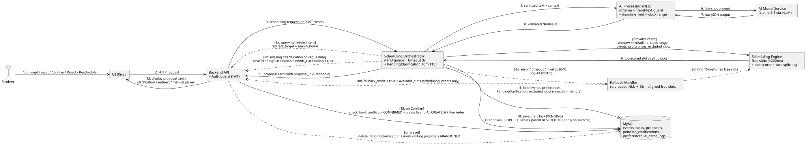

# Đặc tả Kỹ thuật Tính năng: Xếp lịch Thông minh cùng AI (Scheduling with AI)

## 0. Kịch bản Trình bày Luồng Xử lý (Từ Input đến Output - Dành cho Thuyết trình)

Phần này trình bày liền mạch từng kịch bản tiêu biểu của tính năng từ lúc người dùng nhập yêu cầu cho tới khi nhận được kết quả cuối cùng, tập trung vào bản chất xử lý và công nghệ áp dụng ở từng chặng.

### Kịch bản 1 - Luồng chuẩn: Tạo sự kiện hoặc công việc mới với yêu cầu đầy đủ

Khi người dùng nhập một câu yêu cầu xếp lịch vào khung chat của Trợ lý AI (ví dụ: yêu cầu xếp 2 tiếng làm bài tập trước tối Thứ Sáu và tránh buổi tối), hệ thống trước tiên chạy lớp khử thông tin nhạy cảm cá nhân và chuẩn hóa văn bản tiếng Việt/teencode để tạo câu đầu vào sạch. Dữ liệu này được đẩy qua hàng đợi tuần tự FIFO tới mô hình ngôn ngữ lớn cục bộ (`Llama 3.1` vận hành qua `vLLM`) kèm cơ chế ép đầu ra theo khuôn mẫu dữ liệu có cấu trúc (Structured Output) đã định nghĩa sẵn. Ở bước này, AI chỉ đóng vai trò trích xuất các thực thể cần thiết như tên hoạt động, thời lượng hoặc khung giờ mong muốn, mốc ngày, hạn chót, buổi ưu tiên/cần tránh và mức độ quan trọng. Ngay sau khi AI trả JSON, hệ thống áp dụng lớp hậu kiểm đối chiếu chữ gốc để bảo đảm AI không được tự bịa thời lượng hay tự tính ngày tháng ngoài những gì người dùng thực sự đã nói.

Khi đầu vào đã đầy đủ, hệ thống không cho AI tự xếp lịch mà chuyển toàn bộ ràng buộc đã kiểm chứng sang tầng thuật toán tất định. Đầu tiên, bộ quy đổi thời gian chuyển các cụm từ tương đối như "tuần này" hay "thứ sáu" thành khoảng ngày dương lịch cụ thể theo múi giờ Việt Nam `+07:00`, đồng thời khóa chặt cận trên của khung tìm kiếm không vượt quá hạn chót đã nêu. Tiếp đó, thuật toán quét khoảng trống (Sort-and-Sweep chạy dưới 200ms) lấy toàn bộ lịch học, lịch thi, sự kiện cố định hiện có, giờ đi ngủ và thời gian nghỉ đệm 15 phút để loại trừ khỏi quỹ thời gian rảnh trên lưới bước 15 phút. Sau khi có các khoảng trống sạch, thuật toán chấm điểm chọn khung giờ tối ưu nhất theo buổi ưu tiên, buổi cần tránh và khung giờ yêu cầu; nếu công việc kéo dài vượt mức tập trung liên tục cho phép, thuật toán tự động chia nhỏ thành nhiều ca làm việc có khoảng nghỉ xen giữa. Kết quả được lưu ở trạng thái bản nháp đề xuất trên cơ sở dữ liệu MySQL (chưa ghi vào lịch chính thức) và hiển thị lên giao diện dưới dạng Thẻ Đề xuất kèm lời giải thích lý do chọn giờ. Cuối cùng, khi người dùng xem xét và bấm nút Xác nhận (Human-in-the-Loop), hệ thống kiểm tra trùng lịch cứng thêm một lần cuối rồi mới chuyển công việc sang lịch chính thức và kích hoạt nhắc hẹn tương ứng.

### Kịch bản 2 - Luồng bổ sung thông tin nhiều lượt và Đổi lịch (Multi-turn Clarification & Reschedule)

Trong trường hợp người dùng nhập yêu cầu còn thiếu thông tin bắt buộc để xử lý (ví dụ chưa nêu tên công việc, bỏ sót thời lượng cần làm, hoặc dùng cụm ngày mơ hồ như "lúc nào rảnh") hay bấm nút Đổi lịch trên một thẻ đề xuất sẵn có kèm mong muốn điều chỉnh mới (ví dụ "đổi sang buổi chiều"), hệ thống không phỏng đoán đại khái. Với câu lệnh còn thiếu, hệ thống lưu tạm ngữ cảnh hội thoại trong phiên làm việc (có thời hạn hiệu lực 10 phút) rồi trả về câu hỏi làm rõ cụ thể để hỏi lại người dùng.

Ở lượt trả lời tiếp theo, hệ thống ghép câu bổ sung mới với ngữ cảnh đang lưu giữ để tái trích xuất đầy đủ các trường dữ liệu cần thiết; nếu người dùng đang ở luồng Đổi lịch, hệ thống tự kế thừa tên công việc, thời lượng từ thẻ cũ và đưa toàn bộ các khung giờ vừa bị từ chối hoặc đổi lịch trước đó vào bộ nhớ loại trừ. Toàn bộ tập ràng buộc mới lại đi qua thuật toán quét khoảng trống và chấm điểm để tìm ra một phương án thay thế không trùng lại các giờ người dùng không hài lòng. Thẻ đề xuất cũ chỉ được đánh dấu đã đổi lịch sau khi phương án mới tìm thành công, rồi Thẻ Đề xuất mới được gửi ra giao diện chờ người dùng xác nhận. Ngoài ra, nếu người dùng chuyển sang đoạn chat mới hoặc bấm hủy, hệ thống cung cấp thao tác dọn sạch ngữ cảnh chờ và đóng các đề xuất đang treo để không làm nhiễu cuộc trò chuyện tiếp theo.

### Kịch bản 3 - Luồng dự phòng khi AI bận hoặc lỗi (Graceful Fallback sang Chọn thủ công)

Khi hạ tầng suy luận AI cục bộ gặp sự cố như phản hồi chậm quá giới hạn 3 giây, mất kết nối hoặc trả sai định dạng JSON dù đã tự động thử lại một lần, hệ thống lập tức ghi nhận nhật ký lỗi AI phục vụ chẩn đoán và kích hoạt chế độ dự phòng an toàn. Thay vì làm treo giao diện hay báo lỗi hệ thống chung chung, bộ trích xuất dựa trên quy tắc tĩnh (sử dụng biểu thức chính quy và từ điển chuẩn hóa, hoàn toàn không phụ thuộc AI) sẽ tự đọc câu yêu cầu gốc để lấy tên việc, thời lượng, khoảng ngày và khung giờ mong muốn nếu có. Thuật toán tìm khoảng trống tất định sau đó cắt các khoảng rảnh đạt chuẩn lưới 15 phút trong cửa sổ thời gian phù hợp và gửi thẳng danh sách khung giờ khả dụng về giao diện kèm cờ chế độ dự phòng. Trên màn hình ứng dụng, cửa sổ chọn giờ thủ công sẽ mở ra để người dùng chọn trực tiếp một khung giờ trống và lưu thành sự kiện chính thức bình thường.

### Kịch bản 4 - Luồng điều hướng chéo khi gõ nhầm câu hỏi tra cứu (Cross-Tab Redirect)

Khi người dùng vô tình gõ một câu hỏi thuộc phạm vi tra cứu (chẳng hạn hỏi lịch thi trong tuần hoặc hỏi quy chế tín chỉ học vụ) vào ô chat dùng để xếp lịch của Trợ lý AI, tầng hiểu ngôn ngữ nhận diện ý định truy vấn thông tin thay vì tạo hoặc đổi lịch. Hệ thống lập tức dừng quy trình tìm slot, không tạo đề xuất nháp và trả về thông báo giải thích rằng tính năng Trợ lý AI dành cho việc xếp lịch, kèm siêu dữ liệu nút bấm điều hướng một chạm giúp người dùng chuyển thẳng sang màn hình Tìm kiếm để xem lịch cá nhân hoặc hỏi đáp học vụ.

---

## 1. Tóm tắt Kiến trúc Luồng Chạy (Dành cho Nhóm Phát triển)

Tính năng Xếp lịch cùng AI tuân thủ kiến trúc tách bạch nghiêm ngặt giữa **Trích xuất ngữ nghĩa bằng AI (NLU)** và **Tìm kiếm - Chấm điểm lịch trình bằng Thuật toán Tất định**, đảm bảo người dùng luôn kiểm soát bước xác nhận cuối cùng (Human-in-the-Loop):

```text
[INPUT TỪ NGƯỜI DÙNG]
Câu lệnh tự nhiên (xếp mới, tiếp nối làm rõ, đổi lịch kèm reschedule_proposal_id, reset_context)
hoặc thao tác Confirm / Reject / Reset + JWT Token
   |
   +--> Bước 1 (Quản lý Ngữ cảnh & Bộ nhớ Từ chối - MySQL):
   |    Đọc PendingClarification (hạn 10 phút) -> đóng các đề xuất treo cũ (ABANDONED) khi bắt đầu
   |    chủ đề mới, hoặc gom các khung giờ bị từ chối/đổi lịch trước đó vào danh sách excluded_slots.
   |
   +--> Bước 2 (Trích xuất Ngữ nghĩa NLU - Hàng đợi FIFO + Llama 3.1 trên vLLM, timeout 3s):
   |    Khử PII, chuẩn hóa teencode -> ép đầu ra theo JSON Schema (NluResult, retry tối đa 1 lần)
   |    + đối chiếu chữ gốc chống AI tự bịa thời lượng, ngày tháng và hạn chót (deadline_hint).
   |       |
   |       +--> [Nhánh 2a - Gõ nhầm câu hỏi tra cứu lịch/học vụ vào ô Chat]:
   |       |    Trả thông báo điều hướng nhắc chuyển sang tab "Search" (redirect_target = "search_home").
   |       |
   |       +--> [Nhánh 2b - Thiếu thông tin bắt buộc (thiếu title/duration hoặc ngày mơ hồ)]:
   |       |    Lưu PendingClarification, bật needs_clarification = true, trả câu hỏi làm rõ.
   |       |
   |       +--> [Nhánh 2c - AI lỗi / quá 3s]: Ghi AiErrorLog, chạy bộ trích xuất quy tắc dự phòng:
   |            - Ý định xếp/đổi lịch -> trả danh sách giờ trống 15 phút (fallback_mode = true).
   |            - delete_event / unknown -> trả hướng dẫn thao tác (fallback_mode = false).
   |
   +--> Bước 3 (Tìm giờ trống & Chấm điểm Tất định - Python Sort-and-Sweep < 200ms):
   |    Quy đổi cửa sổ thời gian & khóa cận trên theo hạn chót (window_end <= deadline) -> trừ lịch bận,
   |    giờ ngủ, nghỉ đệm và excluded_slots -> chọn slot tối ưu (kể cả trong khoảng giờ rộng như 2pm-5pm)
   |    hoặc chia nhỏ khối việc -> lưu nháp Task (PENDING) + Proposal (PROPOSED) vào MySQL -> trả Proposal Card.
   |
   +--> Bước 4 (Xác nhận của Người dùng ở lượt tương tác tiếp theo - Confirm / Reject):
   |    Khi bấm Confirm, kiểm tra trùng lịch cứng lần cuối (check_hard_conflict) rồi mới đổi
   |    Proposal sang CONFIRMED, Task sang SCHEDULED và tạo Event chính thức (AI_CREATED) + Reminder.
   |
   +--> [OUTPUT]: Thẻ Đề xuất (PROPOSED) / Câu hỏi làm rõ / Nút điều hướng / Khung chọn thủ công.
```

---

## 2. Sơ đồ Kiến trúc Luồng Xử lý (Pipeline Flow Diagram) & Kịch bản Luồng chạy



*(Nguồn PlantUML có thể chỉnh sửa: [assets/scheduling_with_AI.puml](assets/scheduling_with_AI.puml))*

### Mô tả chi tiết các luồng kịch bản trên sơ đồ (theo đúng số thứ tự mũi tên):

Để tránh nhầm lẫn giữa lúc **lưu nháp đề xuất (`Proposal`)** và lúc **chính thức tạo sự kiện trên lịch (`Event`)**, quy trình được tách bạch thành 2 vòng tương tác rõ ràng:

1. **Vòng 1 - Sinh viên nhập câu lệnh để nhận Thẻ Đề xuất (Mũi tên `1 -> 2 -> 3 -> 4 -> 5 -> 6 -> 7 -> 8`):**
   * **`1 -> 2 -> 3`:** Sinh viên nhập yêu cầu bằng ngôn ngữ tự nhiên (hoặc kích hoạt `/api/v1/assistant/reset` khi tạo đoạn chat mới) tại màn hình **Trợ lý AI** (`chat_home`). Giao diện gửi HTTP request kèm JWT Token qua `Backend API` vào `Scheduling Orchestrator`.
   * **`4`:** `Orchestrator` truy vấn `MySQL` để nạp sự kiện hiện có (`events`), cấu hình sinh hoạt (`user_preferences`), ngữ cảnh hỏi đáp chưa xong (`pending_clarifications`) và danh sách các khung giờ người dùng vừa từ chối trong chuỗi cha-con (`excluded_slots` từ bảng `proposals`).
   * **`5 -> 6 -> 7 -> 8`:** Văn bản sau khi khử thông tin nhạy cảm và chuẩn hóa teencode/tiếng Việt không dấu được gửi qua `AI Processing (NLU)` (chạy trong hàng đợi FIFO `broker` để không quá tải GPU) tới `Llama 3.1 (vLLM)`. Kết quả JSON trả về được kiểm tra lược đồ Pydantic (thử lại tối đa 1 lần nếu sai cú pháp/schema) và đối chiếu chữ gốc để tạo đối tượng `NluResult` hợp lệ.
2. **Các nhánh rẽ sau Bước `8` (Chỉ đi theo MỘT trong các nhánh `8a`, `8b`, `8c`, hoặc `8d`):**
   * **Nhánh `[8a: query_schedule intent]` (Gõ nhầm câu hỏi tìm kiếm vào ô Trợ lý AI):**
     * Nếu sinh viên hỏi lịch hoặc hỏi quy chế học vụ (và không đang trong luồng đổi lịch), hệ thống dừng luồng xếp lịch và trả thông báo nhắc chuyển sang tab **Search** kèm `redirect_target = "search_home"`, `redirect_button_label = "Search"`.
   * **Nhánh `[8b: missing title/duration or vague date]` (Thiếu thông tin bắt buộc):**
     * Nếu câu thiếu tên hoạt động (`title`), thiếu thời lượng (`duration_minutes`), chỉ đưa khung giờ trống trơn không có việc cần làm, hoặc dùng cụm ngày mơ hồ, hệ thống lưu bản ghi `PendingClarification` (hiệu lực 10 phút) vào MySQL và trả về `needs_clarification = true` kèm câu hỏi làm rõ cụ thể (`12`), chưa sinh dòng nào trong bảng `proposals`.
   * **Nhánh `[8c: valid intent]` -> `9 -> 10 -> 11 -> 12` (Đủ thông tin - Tìm và Lưu nháp Đề xuất):**
     * **`8c -> 9`:** `Orchestrator` truyền `NluResult` (gồm cửa sổ `[window_start, window_end]` đã khóa cận trên theo `deadline`, cùng `requested_start/requested_end` nếu có), danh sách sự kiện, cấu hình nghỉ ngơi và `excluded_slots` sang `Scheduling Engine` để quét giờ trống (`< 200ms`), chọn khung giờ tối ưu (hoặc tách khối nếu cần).
     * **`10` (Lưu nháp Proposal vào DB trước khi trả về UI):** Chỉ khi tìm được khung giờ phù hợp, nếu là đổi lịch hệ thống mới chuyển đề xuất cha sang `RESCHEDULED`, sau đó lưu `Task (status = PENDING)` và `Proposal (status = PROPOSED)` vào `MySQL` để sinh `proposal_id` thật (lúc này bảng `events` **chưa** có sự kiện mới).
     * **`11 -> 12`:** `Orchestrator` trả thẻ `Proposal Card` (chứa `id`, giờ đề xuất `+07:00`, giải thích `rationale`) qua `API` về hiển thị trên màn hình `UI (Kivy)` cho sinh viên xem xét. Trường `rationale` do BE (`services/proposals.py`) tự động sinh trên mọi `Proposal` để nêu rõ khung giờ trống được chọn không trùng lịch học/giờ ngủ, và hiển thị trên UI dưới nhãn `Why this time was chosen` hoặc `Why this schedule was split`. Khi một công việc buộc phải chia nhỏ thành nhiều khối (`extra_slots` khác rỗng) vì vượt `max_block_minutes` (kèm `min_break_minutes`) hoặc thiếu khoảng trống liên tục đủ dài, `rationale` ghi rõ thêm lý do tách khối này.
   * **Nhánh `[8d: error / timeout / invalid JSON]` -> `9d -> 10d -> 12` (Sự cố AI - Chuyển sang Fallback):**
     * Nếu `vLLM` quá hạn 3 giây, mất kết nối hoặc trả sai JSON sau khi thử lại, `Orchestrator` ghi `AiErrorLog` xuống MySQL và kích hoạt `Fallback Handler`.
     * Với ý định xếp lịch hoặc đổi lịch (hoặc câu có nêu thời lượng/khung giờ), `Fallback Handler` chạy bộ trích xuất quy tắc Python, gọi `Scheduling Engine` lấy danh sách giờ trống căn lưới 15 phút (`9d`) và trả `fallback_mode = true` kèm `available_slots` (`10d -> 12`) để giao diện mở ngay bảng chọn giờ thủ công (`ManualFallbackModal`). Với `delete_event` hoặc `unknown`, hệ thống không bật bảng chọn giờ trống mà trả thông báo hướng dẫn người dùng thao tác đúng chỗ.
3. **Vòng 2 - Sinh viên bấm nút `Confirm` / `Reject` / `Reschedule` trên Thẻ Đề xuất (Mũi tên `1 -> 2 -> [13]`):**
   * Sau khi nhìn thấy Thẻ Đề xuất ở bước `12`, nếu sinh viên bấm nút **Xác nhận (`Confirm`)**, giao diện gửi một HTTP request mới (`1 -> 2`) gọi `POST /api/v1/proposals/{proposal_id}/confirm`.
   * **`[13: on Confirm]`:** Hệ thống kiểm tra lại `check_hard_conflict` lần cuối với bảng `events`, chuyển trạng thái đề xuất có sẵn trong DB từ `PROPOSED` sang `CONFIRMED`, chuyển `Task` sang `SCHEDULED`, **chính thức tạo bản ghi mới trong bảng `events`** (`source = AI_CREATED`) và tạo `Reminder` mặc định (cùng thông tin `room`, `source`, `task_id` trong phản hồi).

---

## 3. Nguyên tắc Rào chắn Vùng xử lý của AI & Vai trò của `NluResult`

### 3.1. Phân định ranh giới AI và Thuật toán Tất định
* **Vùng duy nhất AI được phép xử lý (NLU Layer):** Mô hình `Meta-Llama-3.1-8B-Instruct-AWQ-INT4` trên `vLLM` chỉ đọc câu yêu cầu tự nhiên để điền các trường ngữ nghĩa vào [`NluResult`](services/nlu.py#L77-L123): `intent`, `title`, `duration_minutes`, `priority`, `preferred_time_of_day`, `avoid_time_of_day`, `date_hint`, `deadline_hint`. AI bị cấm tự tính ngày dương lịch, không tự tìm giờ trống và không có quyền ghi vào bảng `events`.
* **Tại sao `NluResult` bắt buộc phải tách riêng trường `deadline_hint` (và `deadline`) khỏi `date_hint`?**
  Sau khi tầng NLU chạy xong, đối tượng `NluResult` được truyền làm đầu vào điều khiển **hai pha xử lý tất định kế tiếp**:
  1. **Pha 1 - Bộ quy đổi cửa sổ và Quét giờ trống (`resolve_date_hint` + [`find_user_free_slots`](services/search_engine.py#L1323-L1381)):** Thuật toán `sort-and-sweep` chỉ tìm các khoảng trống nằm trong đoạn `[window_start, window_end]`. Khi sinh viên nói câu ghép: *"Hạn nộp bài tập CTDL là thứ 6, xếp cho mình 2 tiếng làm bài trong tuần này"*, cụm `"tuần này"` mở rộng `window_end` đến hết tối Chủ Nhật. Nếu không có trường `deadline_hint = "thứ 6"` để khóa cận trên `window_end = min(window_end, deadline)` (tức tối Thứ Sáu) tại [`_finalize`](services/nlu.py#L469-L571), thuật toán `find_user_free_slots` sẽ quét sang cả Thứ Bảy, Chủ Nhật và trả về các khung giờ trễ hạn nộp bài.
  2. **Pha 2 - Chọn khung giờ và Đánh giá chất lượng (Runtime Selection + Rubric 35 điểm):** Tại runtime, bộ chọn khung giờ trong [`services/proposals.py`](services/proposals.py#L69-L139) ưu tiên khung giờ khớp giờ yêu cầu tường minh (hoặc khớp `preferred_time_of_day`, tránh `avoid_time_of_day`, và chọn slot sớm nhất không trùng lịch). Đồng thời, ở tầng đánh giá chất lượng AI (Mục 7), tham số `deadline` là điều kiện tiên quyết để kiểm tra chốt chặn cứng **`No Missed Deadline (+10 điểm)`** ($t_{\text{end}} \le t_{\text{deadline}}$) và chấm **Mục 2 - Khoảng đệm an toàn hạn chót ($S_{2,\text{margin}}$, tối đa `+5` điểm)** dựa trên $t_{\text{deadline}} - t_{\text{end}}$.

---

## 4. Đặc tả Input chặt chẽ, Ba chốt chặn Input & Cơ chế Điều hướng Chéo

### 4.1. Các nhóm Input theo vòng đời xếp lịch
1. **Input gửi yêu cầu tại khung Trợ lý AI ([`POST /api/v1/assistant/understand`](routers/assistant.py#L110-L455)):**
   * Header bắt buộc: `Authorization: Bearer <jwt_token>` (`HTTP 401` nếu thiếu/sai).
   * JSON Body (`UnderstandRequest`):
     * `prompt` (`str`, bắt buộc, độ dài `1..2000` ký tự).
     * `reschedule_proposal_id` (`int | None`, mặc định `None`): Để `None` khi tạo yêu cầu mới; truyền `id` của đề xuất hiện tại khi người dùng bấm nút **Reschedule** kèm lời nhắn điều chỉnh.
     * `reset_context` (`bool`, mặc định `False`): Đặt `True` khi giao diện bắt đầu luồng trò chuyện mới hoặc chuyển phiên chat để xóa `PendingClarification` cũ trước khi phân tích prompt.
2. **Input dọn ngữ cảnh hội thoại ([`POST /api/v1/assistant/reset`](routers/assistant.py#L458-L469)):**
   * Xóa bản ghi `PendingClarification` của `current_user.id` và chuyển các `Proposal` đang `PROPOSED` sang `ABANDONED`.
3. **Input phản hồi trên Thẻ Đề xuất (`Proposal` Action APIs - [`routers/proposals.py`](routers/proposals.py)):**
   * `POST /api/v1/proposals/{proposal_id}/confirm`: Xác nhận đề xuất thành sự kiện chính thức.
   * `POST /api/v1/proposals/{proposal_id}/reject`: Từ chối đề xuất hiện tại.
   * `POST /api/v1/proposals/manual`: Lưu khung giờ người dùng tự chọn từ chế độ Fallback.

### 4.2. Ba chốt chặn kiểm tra tính đầy đủ và trung thực của Input
* **Chốt chặn 1 - Kiểm tra biên cú pháp & Khử nhiễu:** Giới hạn độ dài chuỗi, che thông tin cá nhân (`sanitize_prompt`), chuẩn hóa tiếng Việt không dấu/teencode (`normalize_text`) và giữ nguyên các từ tiếng Anh dễ nhầm với teencode (`gap`, `vs`, `hop`, `lam`) khi câu không có ngữ cảnh tiếng Việt.
* **Chốt chặn 2 - Khóa Schema JSON & Đối chiếu chữ gốc (`Literal-Text Guards`):**
  * Ép đầu ra khớp `NluResult` (`duration_minutes` thuộc `15..720`, `priority` thuộc `1..3`).
  * Nếu câu gốc không có cụm từ chỉ thời lượng (`_DURATION_RE` / `_DURATION_RANGE_RE`) mà LLM tự điền `duration_minutes`, hệ thống xóa về `None`.
  * Chỉ chấp nhận `date_hint` và `deadline_hint` khi cụm từ ngày tháng đó xuất hiện nguyên văn trong câu nói của người dùng (hỗ trợ cả tiếng Việt, tiếng Anh như `Friday`, `November 27`, và định dạng `YYYY-MM-DD`).
* **Chốt chặn 3 - Cổng yêu cầu làm rõ (`Clarification Gate`) & Điều hướng chéo (`Cross-Tab Redirect Gate`):**
  * Nếu `intent == "query_schedule"` (và không thuộc chuỗi đang đổi lịch): trả `message` nhắc chuyển sang trang Search kèm `redirect_target = "search_home"` và `redirect_button_label = "Search"`. Trên giao diện Kivy (`ChatBubble` và handler `on_api_success` trong [`../FE/chat_screen.py`](../FE/chat_screen.py#L904-L926)), khi nhận `redirect_target != None`, giao diện hiển thị thông báo kèm nút chuyển tab gọi thẳng `app.root.current = redirect_target`.
  * Nếu `intent == "schedule_task"` nhưng thiếu `title`, thiếu `duration_minutes`, chỉ có khoảng giờ trống trơn không có việc cần làm, hoặc ngày tháng mơ hồ: bật `needs_clarification = True` kèm `clarification_question` cụ thể bằng tiếng Anh và lưu vào `PendingClarification`. Nếu người dùng gõ lệnh hủy (`cancel`, `hủy`, `thôi`...), hệ thống xóa ngay ngữ cảnh chờ mà không gọi lại LLM.

---

## 5. Quy trình xử lý bên trong (5 bước End-to-End)

1. **Bước 1 - Quản lý Ngữ cảnh & Bộ nhớ Từ chối (Clarification TTL & Rejection Memory):**
   * Nếu `reset_context = True` hoặc chuyển sang chủ đề mới: xóa `PendingClarification` và gọi [`abandon_pending_proposals`](database.py#L198-L213) chuyển các đề xuất đang treo (`PROPOSED`) sang `ABANDONED`.
   * Nếu là câu trả lời nối tiếp trong hạn 10 phút: ghép `original_prompt` với câu mới và kế thừa ngữ cảnh còn giữ.
   * Nếu là yêu cầu xếp lại (`reschedule_proposal_id` khác `None`): xác thực đề xuất cha đang ở trạng thái `PROPOSED` (nếu không, trả `HTTP 409`), sau đó trong `create_proposal` truy vấn chuỗi đề xuất cha-con (`_ancestor_slots`) để đưa toàn bộ các khung giờ đã từ chối/đổi lịch của cùng công việc vào danh sách loại trừ `excluded_slots`.
2. **Bước 2 - Trích xuất NLU & Quy đổi Cửa sổ Thời gian - Hạn chót:**
   * Gọi `understand_prompt` qua hàng đợi FIFO `broker` tới `vLLM` (timeout `3.0s`).
   * Quy đổi `date_hint` sang `[window_start, window_end]` (`+07:00`; mặc định 7 ngày tới nếu `date_hint is None`) và khóa cận trên `window_end = min(window_end, deadline)` khi có `deadline_hint`, đồng thời tách `requested_start/requested_end` cho các cụm giờ cụ thể (hỗ trợ cả `between ... and ...`, `am/pm`).
3. **Bước 3 - Quét Khung giờ Trống (`< 200ms`), Chọn Slot & Chia nhỏ Việc (`services/proposals.py`):**
   * Gọi [`find_user_free_slots`](services/search_engine.py#L1323-L1381) trừ lịch học/thi/sự kiện, giờ ngủ, khoảng nghỉ đệm `min_break_minutes` và `excluded_slots`, căn lưới `15` phút.
   * Nếu người dùng chỉ định khung giờ cụ thể (`explicit_clock`), `_pick_slot` hỗ trợ đặt cả công việc ngắn nằm lọt bên trong cửa sổ rộng (ví dụ đặt 1 tiếng trong khoảng `14:00 - 17:00`, ưu tiên sát đầu khung giờ trước rồi tới slot sớm nhất); nếu thời lượng vượt `max_block_minutes`, `_clip_gaps_to_clock_window` cắt khoảng trống vào khung giờ yêu cầu rồi gọi `split_task` chia nhỏ khối việc kèm thời gian nghỉ.
   * Nếu không có khung giờ cố định, `_pick_slot` chọn slot đạt điểm tốt nhất theo `preferred_time_of_day`, tránh `avoid_time_of_day` và ưu tiên giờ sớm; nếu không đủ một khoảng liền mạch, gọi `split_task`. Sau đó lưu `Task (PENDING)` + `Proposal (PROPOSED)` xuống MySQL (nếu đang reschedule thì lúc này mới chuyển đề xuất cha sang `RESCHEDULED`).
4. **Bước 4 - Xử lý Nhánh Sự cố AI (Graceful Fallback):**
   * Nếu `vLLM` quá hạn 3 giây hoặc lỗi định dạng, ghi `AiErrorLog`, chạy `rule_based_understand`. Đối với ý định xếp/đổi lịch (hoặc prompt có thời lượng/khung giờ), gọi `find_user_free_slots` và `_slice_fallback_slots` (căn bội số 15 phút) trả `fallback_mode = True` kèm `available_slots` cho bảng chọn giờ thủ công. Đối với `delete_event` và `unknown`, đặt `fallback_mode = False` và trả hướng dẫn thao tác phù hợp.
5. **Bước 5 - Xác nhận hoặc Từ chối Đề xuất (Human-in-the-Loop Commit):**
   * Khi người dùng bấm `Confirm`, chạy lại [`check_hard_conflict`](services/validator.py#L189-L206); nếu không trùng cứng, tạo bản ghi `Event` (`source = AI_CREATED`) + `Reminder` mặc định (30 phút trước giờ bắt đầu) và cập nhật `Proposal -> CONFIRMED`, `Task -> SCHEDULED`.

---

## 6. Đặc tả Output tương ứng cho từng Kịch bản
1. **Kịch bản 1 - Đề xuất xếp lịch thành công (`HTTP 200 OK`):** Trả `nlu` (`fallback_mode = False`, `needs_clarification = False`), đối tượng `proposal` (`id`, `task_id`, `parent_id`, `title`, `duration_minutes`, `priority`, `start_time` `+07:00`, `end_time` `+07:00`, `extra_slots`, `rationale`, `status = "PROPOSED"`) và `abandoned_proposals`. Trường `rationale` luôn xuất hiện trên mọi `Proposal` do BE (`services/proposals.py`) sinh tự động để nêu rõ khung giờ trống phù hợp đã chọn; khi công việc buộc phải chia thành nhiều khối (`extra_slots` khác rỗng) vì vượt `max_block_minutes` hoặc thiếu khoảng trống liền mạch đủ dài, trường này nêu thêm lý do tách khối.
2. **Kịch bản 2 - Điều hướng chéo sang trang Tìm kiếm (`HTTP 200 OK`):** Khi `nlu.intent == "query_schedule"`, trả `message` nhắc chuyển tab bằng tiếng Anh, `redirect_target = "search_home"` và `redirect_button_label = "Search"`.
3. **Kịch bản 3 - Thiếu thông tin hoặc Lệnh hủy (`HTTP 200 OK`):** Nếu thiếu thông tin, trả `nlu` với `needs_clarification = True`, `clarification_question` cụ thể bằng tiếng Anh và `proposal = None`. Nếu hủy hội thoại, trả `intent = "unknown"`, `message = "Clarification cancelled."`.
4. **Kịch bản 4 - Chuyển sang chế độ Fallback (`HTTP 200 OK`):** Với ý định xếp lịch, trả `nlu` từ quy tắc (`fallback_mode = True`), `message` báo chuyển chế độ chọn trực tiếp bằng tiếng Anh và danh sách `available_slots` căn lưới 15 phút.

---

## 7. Công thức Chấm điểm Phương án & Thang Đánh giá Chất lượng AI (Rubric 35 Điểm & Ví dụ Minh họa)

### 7.1. Giải thích nguyên lý: Tại sao chấm điểm khung giờ đề xuất cuối cùng dựa trên Prompt gốc lại đánh giá chính xác AI?
Nếu chỉ chấm riêng lẻ đầu ra JSON của mô hình NLU, ta mới chỉ biết mô hình điền đúng bao nhiêu trường từ vựng nhưng không định lượng được mức độ ảnh hưởng của một lỗi trích xuất lên lịch trình thực tế của sinh viên, đồng thời không chứng minh được tính năng xếp lịch của hệ thống tốt hơn việc đặt ngẫu nhiên vào giờ rảnh (Random/First-Fit) bao nhiêu điểm.

Ngược lại, khi dùng công thức đánh giá 35 điểm trong bộ kiểm định QA để chấm **Khung giờ Đề xuất Cuối cùng ($p_i$) đối chiếu trực tiếp với các Ràng buộc Thật trong Câu Prompt Gốc của Người dùng**:
* Thuật toán tìm lịch và chọn slot phía sau là tất định (chạy 1000 lần như nhau nếu cùng đầu vào), nhưng nó phụ thuộc hoàn toàn vào các tham số do AI trích xuất (`duration_minutes`, `deadline`, `priority`, `preferred_time_of_day`, `avoid_time_of_day`).
* Nếu AI trích xuất **đúng 100%** ý người dùng trong prompt gốc, hệ thống nhận đúng ràng buộc và cho ra phương án đạt điểm cao nhất (`30 - 35/35` điểm).
* Nếu AI trích xuất **sai hoặc sót dù chỉ 1 ràng buộc** (ví dụ: câu gốc ghi *"hạn nộp tối thứ 6"* mà AI làm rơi mất `deadline_hint`, hoặc câu gốc ghi *"đừng xếp buổi tối"* mà AI bỏ sót `avoid_time_of_day`), bộ chọn slot phía sau có thể chọn khung giờ rơi vào **sáng Thứ Bảy** (bị nhân `0` điểm vì trễ hạn thật của prompt!) hoặc chọn khung giờ **buổi tối** (mất điểm Mục 1!).

Như vậy, đối chiếu đầu ra cuối cùng với Prompt gốc vừa **chấm trực tiếp độ chính xác hiểu ngôn ngữ của AI**, vừa **đo lường giá trị chất lượng lịch trình đầu cuối**.

### 7.2. Công thức Tổng quát (Tối đa 35 điểm / kịch bản hợp lệ)

$$\text{ScheduleScore}(p_i) = G_{\text{overlap}}(p_i) \times G_{\text{deadline}}(p_i) \times \left( 10 + 10 + S_{1,\text{balance}}(p_i) + S_{2,\text{margin}}(p_i) + S_{4,\text{packing}}(p_i) \right)$$

1. **Hai tiêu chí nền tảng bắt buộc (Mỗi tiêu chí `+10` điểm, đồng thời là cổng nhân cứng $G \in \{0, 1\}$):**
   * **Zero-Overlap (`+10` điểm; $G_{\text{overlap}} \in \{0, 1\}$):** Khung giờ đề xuất không chồng lấn bất kỳ tiết học (`CLASS`), lịch thi (`EXAM`), sự kiện (`EVENT`), công việc đã chốt (`TASK`), không vi phạm giờ ngủ, đảm bảo khoảng nghỉ đệm `min_break_minutes` (`15` phút) và không lặp lại khung giờ đã từ chối (`excluded_slots`). Vi phạm -> $G_{\text{overlap}} = 0$ (toàn phương án nhận `0/35` điểm).
   * **No Missed Deadline (`+10` điểm; $G_{\text{deadline}} \in \{0, 1\}$):** Thời điểm hoàn thành công việc không vượt quá mốc hạn chót thực tế nêu trong câu gốc ($t_{\text{end}} \le t_{\text{deadline}}$). Vi phạm (ví dụ hạn Thứ Sáu nhưng gợi ý sáng Thứ Bảy) -> $G_{\text{deadline}} = 0$ (toàn phương án nhận `0/35` điểm).
2. **Ba tiêu chí tối ưu chất lượng sắp xếp (Kế thừa mục 1, 2, 4; mỗi mục tối đa `+5` điểm):**
   * **Mục 1 - Cân bằng tải trong ngày & Tuân thủ buổi ($S_{1,\text{balance}} \in [0, 5]$):**

     $$S_{1,\text{balance}}(p_i) = 5 \times I_{\text{pref}}(p_i) \times \max\left(0, 1 - \frac{t_{\text{busy}}}{480}\right)$$

     Trong đó $t_{\text{busy}}$ là tổng số phút đã bận sẵn trong ngày chứa khung giờ $p_i$ (trước khi xếp việc mới), ngưỡng tải chuẩn mỗi ngày là `480` phút (8 tiếng); $I_{\text{pref}} = 1$ nếu khung giờ tuân thủ đúng buổi ưu tiên / buổi cần tránh trong câu gốc, và bằng $0$ nếu AI hiểu sai dẫn tới xếp vào buổi người dùng đã cấm.
   * **Mục 2 - Độ an toàn hạn chót & Trọng số ưu tiên ($S_{2,\text{margin}} \in [0, 5]$):**

     $$S_{2,\text{margin}}(p_i) = 5 \times \min\left(1.0, \frac{\Delta t_{\text{margin}}}{24.0}\right)$$

     Với việc có mức ưu tiên cao (`priority = 1` - gấp/ôn thi/sắp nộp), khung giờ hoàn thành trước hạn chót $\Delta t_{\text{margin}} \ge 24$ giờ đạt trọn `+5.0` điểm; nếu xếp sát nút trước hạn chót dưới `24` giờ thì điểm giảm tỷ lệ thuận theo số giờ đệm thực tế.
   * **Mục 4 - Chống phân mảnh lịch trống ($S_{4,\text{packing}} \in [0, 5]$):**
     * Đạt **`+5.0` điểm** nếu công việc được xếp nguyên 1 khối liên tục và đặt sát biên đầu hoặc biên cuối của khoảng trống lớn (khoảng trống còn dư ở đầu/cuối bằng `0` phút hoặc $\ge 60$ phút để tái sử dụng được cho việc khác).
     * Đạt **`+2.5` điểm** nếu đặt lửng lơ ở giữa khoảng trống lớn làm băm nhỏ hai đầu thành các mảnh vụn khó dùng ($0 < \text{khoảng hở hai bên} < 60$ phút).
     * Nhận **`0.0` điểm** nếu tự ý chia cắt công việc thành nhiều mảnh rời rạc khi vẫn còn khoảng trống liên tục đủ dài.

### 7.3. Ví dụ minh họa cách tính điểm trực tiếp (Kịch bản phức tạp đa ràng buộc)

* **Thời điểm hiện tại (`reference_now`):** Sáng Thứ Tư `11/11/2026` lúc `08:00 (+07:00)`.
* **Câu Prompt gốc của sinh viên đưa vào khung Trợ lý AI:**
  > *"Hạn nộp bài tập lớn CTDL là 23:59 thứ sáu tuần này, xếp gấp cho mình 2 tiếng làm bài trong tuần này nhé, đừng xếp vào buổi tối vì tối mình bận việc nhà."*
* **Nhãn chuẩn từ câu Prompt gốc (Ground-Truth Constraints):**
  * Thời lượng yêu cầu: `120` phút (2 tiếng).
  * Độ ưu tiên: `priority = 1` (`"xếp gấp"`).
  * Hạn chót thực tế (`ground_truth_deadline`): Thứ Sáu `13/11/2026` lúc `23:59`.
  * Buổi bị cấm (`avoid_time_of_day`): `"evening"` (cấm từ `18:00` trở đi).
* **Trạng thái lịch hiện tại của sinh viên từ Thứ Tư đến Thứ Bảy:**
  * **Thứ Tư `11/11`:** Đã học chính khóa chỉ **120 phút** (`09:00 - 11:00`). Buổi chiều trống lớn từ `13:00 - 17:00`; buổi tối trống từ `19:00 - 22:00`.
  * **Thứ Sáu `13/11`:** Ngày học rất nặng, đã bận **360 phút** (6 tiếng học từ `07:30 - 11:30` và `13:00 - 15:00`). Cuối buổi chiều còn trống `15:30 - 17:30` (đã tính 15 phút nghỉ đệm).
  * **Thứ Bảy `14/11`:** Trống cả ngày (`00` phút bận).

Hãy chấm điểm trực tiếp **4 trường hợp kết quả đầu ra** để thấy rõ sự khác biệt:

#### Trường hợp 1: AI bóc tách chuẩn xác 100% + Hệ thống chọn phương án tối ưu
* **AI trích xuất:** `duration_minutes = 120`, `priority = 1`, `date_hint = "tuần này"`, `deadline_hint = "thứ sáu"`, `avoid_time_of_day = "evening"`.
* **Khung giờ hệ thống đề xuất ($p_1$):** **Chiều Thứ Tư `11/11` từ `13:00 - 15:00`** (đặt sát biên đầu của khoảng trống `13:00 - 17:00`, chừa lại trọn vẹn `15:00 - 17:00` = 120 phút liên tục cho việc khác).
* **Chấm điểm từng thành phần:**
  1. **Zero-Overlap:** Không đè lên giờ học `09:00 - 11:00`, cách giờ học buổi sáng 2 tiếng (> 15 phút nghỉ đệm) -> **$G_{\text{overlap}} = 1$** (`+10` điểm).
  2. **No Missed Deadline:** Hoàn thành lúc `15:00 Thứ Tư`, trước hạn chót `23:59 Thứ Sáu` -> **$G_{\text{deadline}} = 1$** (`+10` điểm).
  3. **Mục 1 ($S_{1,\text{balance}}$):** Xếp vào buổi chiều (tuân thủ đúng lệnh cấm buổi tối -> $I_{\text{pref}} = 1$). Ngày Thứ Tư chỉ mới bận `120` phút:

     $$S_{1,\text{balance}} = 5 \times 1 \times \left(1 - \frac{120}{480}\right) = 5 \times 0.75 = \mathbf{3.75} \text{ điểm}$$

  4. **Mục 2 ($S_{2,\text{margin}}$):** Hoàn thành lúc `15:00 Thứ Tư`, sớm hơn hạn chót `23:59 Thứ Sáu` tới **`57` giờ** ($\ge 24$ giờ):

     $$S_{2,\text{margin}} = 5 \times \min\left(1.0, \frac{57.0}{24.0}\right) = \mathbf{5.00} \text{ điểm}$$

  5. **Mục 4 ($S_{4,\text{packing}}$):** Xếp liền 1 khối 120 phút sát mép đầu `13:00`, phần dư phía sau còn `120` phút ($\ge 60$ phút) không gây phân mảnh -> **$S_{4,\text{packing}} = \mathbf{5.00}$ điểm**.

  * **Tổng điểm Trường hợp 1:**

    $$\text{ScheduleScore}(p_1) = 1 \times 1 \times (10 + 10 + 3.75 + 5.00 + 5.00) = \mathbf{33.75 / 35} \text{ điểm}$$

#### Trường hợp 2: AI làm sót thông tin phủ định (`avoid_time_of_day = null`)
* **Giả định lỗi của AI:** AI trích xuất đúng hạn Thứ Sáu nhưng quên mất vế *"đừng xếp vào buổi tối"*, dẫn tới gợi ý khung giờ **Tối Thứ Tư `11/11` từ `19:00 - 21:00`**.
* **Chấm điểm:**
  * Không trùng lịch cứng và trước hạn Thứ Sáu -> $G_{\text{overlap}} = 1, G_{\text{deadline}} = 1$ (`20` điểm nền).
  * **Mục 1 ($S_{1,\text{balance}}$):** Vì rơi vào buổi tối trái với ràng buộc thật trong câu gốc của sinh viên -> hệ số tuân thủ buổi **$I_{\text{pref}} = 0$**, kéo $S_{1,\text{balance}} = \mathbf{0.00}$ điểm.
  * **Mục 2 ($S_{2,\text{margin}}$):** Trước hạn 51 giờ -> `+5.00` điểm; **Mục 4 ($S_{4,\text{packing}}$):** Sát biên đầu `19:00` -> `+5.00` điểm.
  * **Tổng điểm Trường hợp 2:** $1 \times 1 \times (10 + 10 + 0.00 + 5.00 + 5.00) = \mathbf{30.00 / 35}$ **điểm** (bị phạt mất 3.75 điểm do lỗi NLU không bắt được phủ định buổi tối).

#### Trường hợp 3: Cách xếp "Quăng đại" vào ngày nặng lịch, sát hạn chót và băm nhỏ khoảng trống
* **Khung giờ giả định ($p_3$):** Xếp vào **Chiều Thứ Sáu `13/11` từ `16:00 - 18:00`** (nằm lửng lơ giữa khoảng trống `15:30 - 18:30`, chừa 2 mảnh vụn 30 phút ở hai đầu, vào ngày đã học 6 tiếng và chỉ cách hạn nộp vài tiếng).
* **Chấm điểm:**
  1. $G_{\text{overlap}} = 1$ (`+10` điểm), $G_{\text{deadline}} = 1$ (`+10` điểm).
  2. **Mục 1 ($S_{1,\text{balance}}$):** Ngày Thứ Sáu đã bận sẵn `360` phút:

     $$S_{1,\text{balance}} = 5 \times 1 \times \left(1 - \frac{360}{480}\right) = 5 \times 0.25 = \mathbf{1.25} \text{ điểm}$$

  3. **Mục 2 ($S_{2,\text{margin}}$):** Làm xong lúc `18:00 Thứ Sáu`, chỉ cách hạn chót `23:59 Thứ Sáu` đúng **`6` giờ**:

     $$S_{2,\text{margin}} = 5 \times \min\left(1.0, \frac{6.0}{24.0}\right) = 5 \times 0.25 = \mathbf{1.25} \text{ điểm}$$

  4. **Mục 4 ($S_{4,\text{packing}}$):** Đặt ở giữa khoảng trống làm dư 2 mảnh 30 phút (< 60 phút) ở hai đầu -> **$S_{4,\text{packing}} = \mathbf{2.50}$ điểm**.
  * **Tổng điểm Trường hợp 3:** $1 \times 1 \times (10 + 10 + 1.25 + 1.25 + 2.50) = \mathbf{25.00 / 35}$ **điểm** (thấp hơn hẳn mức `33.75` điểm của phương án tối ưu).

#### Trường hợp 4: AI làm rơi mất `deadline_hint` khiến hệ thống gợi ý sang sáng Thứ Bảy
* **Giả định lỗi nghiêm trọng của AI:** AI chỉ lấy `date_hint = "tuần này"` mà bỏ sót `deadline_hint = "thứ sáu"`. Thấy Thứ Bảy `14/11` rảnh cả ngày (`busy = 0` phút), hệ thống đề xuất **Sáng Thứ Bảy `14/11` từ `08:00 - 10:00`**.
* **Chấm điểm:**
  * Dù ngày Thứ Bảy rảnh rỗi đạt điểm cân bằng tải và chống phân mảnh tuyệt đối, nhưng $t_{\text{end}} = \text{10:00 Thứ Bảy} > \text{23:59 Thứ Sáu}$ (trễ hạn nộp bài).
  * Chốt chặn cứng **$G_{\text{deadline}}(p_4) = 0$** lập tức kích hoạt:

    $$\text{ScheduleScore}(p_4) = 1 \times 0 \times (10 + 0 + 5.00 + 0.00 + 5.00) = \mathbf{0.00 / 35} \text{ điểm (Loại bỏ)}$$
