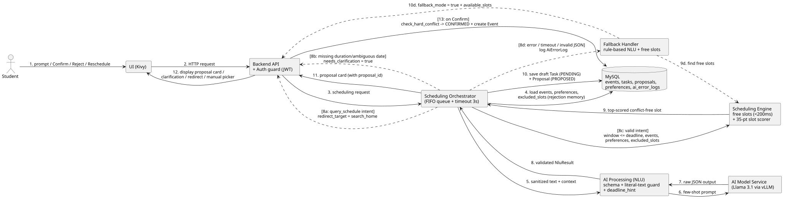

# Đặc tả Kỹ thuật Tính năng: Xếp lịch Thông minh cùng AI (Scheduling with AI)

## 0. Tóm tắt Luồng Hoạt động (Dành cho Thuyết trình & Đồng bộ Liên nhóm FE / DB / AI-Host)

Tính năng Xếp lịch cùng AI tuân thủ kiến trúc tách bạch nghiêm ngặt giữa **Trích xuất ngữ nghĩa bằng AI (NLU)** và **Tìm kiếm - Chấm điểm lịch trình bằng Thuật toán Tất định**, đảm bảo người dùng luôn kiểm soát bước xác nhận cuối cùng (Human-in-the-Loop):

```text
[INPUT TỪ NGƯỜI DÙNG]
Câu lệnh tự nhiên (xếp mới hoặc xếp lại kèm reschedule_proposal_id) / Nút Confirm - Reject + JWT Token
   |
   +--> Bước 1 (Quản lý Ngữ cảnh & Bộ nhớ Từ chối - MySQL):
   |    Đóng các đề xuất treo cũ (ABANDONED) hoặc gom các khung giờ vừa bị từ chối/đổi lịch
   |    của cùng công việc vào danh sách loại trừ (excluded_slots).
   |
   +--> Bước 2 (Trích xuất Ngữ nghĩa NLU - Hàng đợi FIFO + Llama 3.1 trên vLLM, timeout 3s):
   |    Khử PII, chuẩn hóa teencode -> ép đầu ra theo JSON Schema (NluResult) + đối chiếu chữ gốc
   |    chống AI tự bịa thời lượng, ngày tháng và hạn chót (deadline_hint).
   |       |
   |       +--> [Nhánh 2a - Gõ nhầm câu hỏi tra cứu lịch/học vụ vào ô Chat]:
   |       |    Trả thông báo điều hướng "It seems..." nhắc bấm nút "Tìm kiếm" (redirect_target = "search_home").
   |       |
   |       +--> [Nhánh 2b - Thiếu thông tin bắt buộc]: Bật cờ needs_clarification = true,
   |       |    trả câu hỏi yêu cầu bổ sung thời lượng/ngày rõ ràng (chưa sinh Proposal).
   |       |
   |       +--> [Nhánh 2c - AI lỗi / quá 3s]: Ghi AiErrorLog, chạy bộ trích xuất quy tắc dự phòng
   |            + trả danh sách giờ trống (fallback_mode = true) cho giao diện chọn thủ công.
   |
   +--> Bước 3 (Tìm giờ trống & Chấm điểm Xếp hạng Tất định - Python Sort-and-Sweep < 200ms):
   |    Quy đổi cửa sổ thời gian & khóa cận trên theo hạn chót (window_end <= deadline) -> trừ lịch bận,
   |    giờ ngủ, nghỉ đệm 15p và excluded_slots -> chấm điểm chọn khung giờ tối ưu (thang 35 điểm)
   |    -> lưu nháp Task (PENDING) và Proposal (PROPOSED) vào MySQL -> gửi Proposal Card về UI.
   |
   +--> Bước 4 (Xác nhận của Người dùng ở lượt tương tác tiếp theo - Confirm / Reject):
   |    Khi người dùng bấm Confirm trên thẻ, kiểm tra trùng lịch cứng lần cuối (check_hard_conflict)
   |    rồi mới đổi Proposal sang CONFIRMED và sinh bản ghi Event chính thức (AI_CREATED) xuống MySQL.
   |
   +--> [OUTPUT]: Thẻ Đề xuất tối ưu (PROPOSED) / Câu hỏi làm rõ / Nút điều hướng / Khung chọn thủ công.
```

---

## 1. Sơ đồ Kiến trúc Luồng Xử lý (Pipeline Flow Diagram) & Kịch bản Luồng chạy

> **Ghi chú hiển thị sơ đồ:** Khuyến nghị xuất sơ đồ PlantUML (`scheduling_with_AI.puml`) ra định dạng vector **`.svg`** (thay vì `.png`) và đặt tại `sourceCode/BE/assets/scheduling_with_AI.svg` để mọi nhánh số thứ tự hiển thị sắc nét khi thu phóng.



### Mô tả chi tiết các luồng kịch bản trên sơ đồ (theo đúng số thứ tự mũi tên):

Để tránh nhầm lẫn giữa lúc **lưu nháp đề xuất (`Proposal`)** và lúc **chính thức tạo sự kiện trên lịch (`Event`)**, quy trình được tách bạch thành 2 vòng tương tác rõ ràng:

1. **Vòng 1 - Sinh viên nhập câu lệnh để nhận Thẻ Đề xuất (Mũi tên `1 -> 2 -> 3 -> 4 -> 5 -> 6 -> 7 -> 8`):**
   * **`1 -> 2 -> 3`:** Sinh viên nhập yêu cầu bằng ngôn ngữ tự nhiên vào màn hình **Trợ lý AI** (`chat_home`). Giao diện gửi HTTP POST kèm JWT Token qua `Backend API` vào `Scheduling Orchestrator`.
   * **`4`:** `Orchestrator` truy vấn `MySQL` để nạp sự kiện hiện có (`events`), cấu hình sinh hoạt (`user_preferences`) và danh sách các khung giờ người dùng vừa từ chối trong phiên hiện tại (`excluded_slots` từ bảng `proposals`).
   * **`5 -> 6 -> 7 -> 8`:** Văn bản sau khi khử thông tin nhạy cảm và chuẩn hóa teencode được gửi qua `AI Processing (NLU)` tới `Llama 3.1 (vLLM)`. Kết quả JSON trả về được kiểm tra lược đồ Pydantic và đối chiếu chữ gốc để tạo đối tượng `NluResult` hợp lệ.
2. **Các nhánh rẽ sau Bước `8` (Chỉ đi theo MỘT trong các nhánh `8a`, `8b`, `8c`, hoặc `8d`):**
   * **Nhánh `[8a: query_schedule intent]` (Gõ nhầm câu hỏi tìm kiếm vào ô Trợ lý AI):**
     * Nếu sinh viên hỏi lịch hoặc hỏi quy chế học vụ, hệ thống dừng luồng xếp lịch và trả thông báo nhắc chuyển sang tab **Tìm kiếm** kèm `redirect_target = "search_home"`, `redirect_button_label = "Tìm kiếm"`.
   * **Nhánh `[8b: missing duration/ambiguous date]` (Thiếu thông tin bắt buộc):**
     * Nếu sinh viên quên nêu thời lượng cần làm hoặc nói ngày quá mơ hồ, hệ thống trả về `needs_clarification = true` kèm câu hỏi làm rõ (`12`), chưa ghi bất kỳ dòng nào vào bảng `proposals`.
   * **Nhánh `[8c: valid intent]` -> `9 -> 10 -> 11 -> 12` (Đủ thông tin - Tìm và Lưu nháp Đề xuất):**
     * **`8c -> 9`:** `Orchestrator` truyền `NluResult` (gồm cửa sổ `[window_start, window_end]` đã khóa cận trên theo `deadline`), danh sách sự kiện, cấu hình nghỉ ngơi và `excluded_slots` sang `Scheduling Engine` để quét giờ trống (`< 200ms`) và chấm điểm trên thang 35 điểm, chọn ra khung giờ tối ưu nhất.
     * **`10` (Lưu nháp Proposal vào DB trước khi trả về UI):** `Orchestrator` lưu bản ghi `Task (status = PENDING)` và `Proposal (status = PROPOSED)` vào `MySQL` để sinh mã định danh `proposal_id` thật (lúc này bảng `events` **chưa** có sự kiện mới).
     * **`11 -> 12`:** `Orchestrator` trả thẻ `Proposal Card` (chứa `proposal_id`, giờ đề xuất `+07:00`, lý do chọn giờ `rationale`) qua `API` về hiển thị trên màn hình `UI (Kivy)` cho sinh viên xem xét.
   * **Nhánh `[8d: error / timeout / invalid JSON]` -> `9d -> 10d -> 12` (Sự cố AI - Chuyển sang Fallback):**
     * Nếu `vLLM` quá hạn 3 giây, tắt máy hoặc trả sai JSON sau khi thử lại, `Orchestrator` ghi `AiErrorLog` xuống MySQL và kích hoạt `Fallback Handler`.
     * `Fallback Handler` chạy bộ trích xuất quy tắc Python, gọi `Scheduling Engine` lấy danh sách giờ trống (`9d`) và trả `fallback_mode = true` kèm `available_slots` (`10d -> 12`) để giao diện mở ngay bảng chọn giờ thủ công (`ManualFallbackModal`).
3. **Vòng 2 - Sinh viên bấm nút `Confirm` / `Reject` / `Reschedule` trên Thẻ Đề xuất (Mũi tên `1 -> 2 -> [13]`):**
   * Sau khi nhìn thấy Thẻ Đề xuất ở bước `12`, nếu sinh viên bấm nút **Xác nhận (`Confirm`)**, giao diện gửi một HTTP request mới (`1 -> 2`) gọi `POST /api/v1/proposals/{proposal_id}/confirm`.
   * **`[13: on Confirm]`:** Hệ thống kiểm tra lại `check_hard_conflict` lần cuối với bảng `events`, chuyển trạng thái đề xuất có sẵn trong DB từ `PROPOSED` sang `CONFIRMED`, chuyển `Task` sang `SCHEDULED` và **chính thức tạo bản ghi mới trong bảng `events`** (`source = AI_CREATED`).

---

## 2. Nguyên tắc Rào chắn Vùng xử lý của AI & Vai trò của `NluResult`

### 2.1. Phân định ranh giới AI và Thuật toán Tất định
* **Vùng duy nhất AI được phép xử lý (NLU Layer):** Mô hình `Meta-Llama-3.1-8B-Instruct-AWQ-INT4` trên `vLLM` chỉ đọc câu yêu cầu tự nhiên để điền các trường ngữ nghĩa vào [`NluResult`](file:///C:/Users/heyto/projects/AI-assistant-project-team04/sourceCode/BE/services/nlu.py#L78-L102): `intent`, `title`, `duration_minutes`, `priority`, `preferred_time_of_day`, `avoid_time_of_day`, `date_hint`, `deadline_hint`. AI bị cấm tự tính ngày dương lịch, không tự tìm giờ trống và không có quyền ghi vào bảng `events`.
* **Tại sao `NluResult` bắt buộc phải tách riêng trường `deadline_hint` (và `deadline`) khỏi `date_hint`?**
  Sau khi tầng NLU chạy xong, đối tượng `NluResult` được truyền làm đầu vào điều khiển **hai thuật toán tất định kế tiếp**:
  1. **Thuật toán 1 - Bộ quy đổi cửa sổ và Quét giờ trống (`resolve_date_hint` + [`find_user_free_slots`](file:///C:/Users/heyto/projects/AI-assistant-project-team04/sourceCode/BE/services/search_engine.py#L906-L958)):** Thuật toán `sort-and-sweep` chỉ tìm các khoảng trống nằm trong đoạn `[window_start, window_end]`. Khi sinh viên nói câu ghép: *"Hạn nộp bài tập CTDL là thứ 6, xếp cho mình 2 tiếng làm bài trong tuần này"*, cụm `"tuần này"` mở rộng `window_end` đến hết tối Chủ Nhật. Nếu không có trường `deadline_hint = "thứ 6"` để khóa cận trên `window_end = min(window_end, deadline)` (tức tối Thứ Sáu) tại [`_finalize`](file:///C:/Users/heyto/projects/AI-assistant-project-team04/sourceCode/BE/services/nlu.py#L319-L326), thuật toán `find_user_free_slots` sẽ quét sang cả Thứ Bảy, Chủ Nhật và trả về các khung giờ trễ hạn nộp bài.
  2. **Thuật toán 2 - Hàm chấm điểm xếp hạng khung giờ (`Slot Scorer` - thang 35 điểm):** Hàm chấm điểm cần biết chính xác mốc `deadline` để: (a) kiểm tra chốt chặn cứng **`No Missed Deadline (+10 điểm)`** ($\text{proposed\_end} \le \text{deadline}$), và (b) tính khoảng cách thời gian từ lúc hoàn thành công việc đến hạn chót ($\text{deadline} - \text{proposed\_end}$) nhằm chấm **Mục 2 - Khoảng đệm an toàn hạn chót ($S_{2,\text{margin}}$, tối đa `+5` điểm)**, giúp ưu tiên xếp việc sớm thay vì sát giờ nộp.

---

## 3. Đặc tả Input chặt chẽ, Ba chốt chặn Input & Cơ chế Điều hướng Chéo

### 3.1. Các nhóm Input theo vòng đời xếp lịch
1. **Input gửi yêu cầu tại khung Trợ lý AI ([`POST /api/v1/assistant/understand`](file:///C:/Users/heyto/projects/AI-assistant-project-team04/sourceCode/BE/routers/assistant.py#L31-L82)):**
   * Header bắt buộc: `Authorization: Bearer <jwt_token>` (`HTTP 401` nếu thiếu/sai).
   * JSON Body (`UnderstandRequest`):
     * `prompt` (`str`, bắt buộc, độ dài `1..2000` ký tự).
     * `reschedule_proposal_id` (`int | None`, mặc định `None`): Để `None` khi tạo yêu cầu mới; truyền `id` của đề xuất hiện tại khi người dùng bấm nút **Reschedule** kèm lời nhắn điều chỉnh.
2. **Input phản hồi trên Thẻ Đề xuất (`Proposal` Action APIs):**
   * `POST /api/v1/proposals/{proposal_id}/confirm`: Xác nhận đề xuất thành sự kiện chính thức.
   * `POST /api/v1/proposals/{proposal_id}/reject`: Từ chối đề xuất hiện tại.

### 3.2. Ba chốt chặn kiểm tra tính đầy đủ và trung thực của Input
* **Chốt chặn 1 - Kiểm tra biên cú pháp & Khử nhiễu:** Giới hạn độ dài chuỗi, che thông tin cá nhân (`sanitize_prompt`) và chuẩn hóa tiếng Việt không dấu/teencode (`normalize_text`).
* **Chốt chặn 2 - Khóa Schema JSON & Đối chiếu chữ gốc (`Literal-Text Guards`):**
  * Ép đầu ra khớp `NluResult` (`duration_minutes` thuộc `15..720`, `priority` thuộc `1..3`).
  * Nếu câu gốc không có cụm từ chỉ thời lượng (`_DURATION_RE`) mà LLM tự điền `duration_minutes`, hệ thống xóa về `None`.
  * Chỉ chấp nhận `date_hint` và `deadline_hint` khi cụm từ ngày tháng đó xuất hiện nguyên văn trong câu nói của người dùng.
* **Chốt chặn 3 - Cổng yêu cầu làm rõ (`Clarification Gate`) & Điều hướng chéo (`Cross-Tab Redirect Gate`):**
  * Nếu `intent == "query_schedule"` (người dùng hỏi lịch/học vụ trong khung Trợ lý AI): trả `message` nhắc chuyển sang trang Tìm kiếm kèm `redirect_target = "search_home"` và `redirect_button_label = "Tìm kiếm"`. Trên giao diện Kivy (`ChatBubble` trong [`sourceCode/FE/chat_screen.py`](file:///C:/Users/heyto/projects/AI-assistant-project-team04/sourceCode/FE/chat_screen.py#L133-L172)), khi nhận `redirect_target != None`, bong bóng chat có thể gắn trực tiếp một nút `MDButton` gọi `MDApp.get_running_app().root.current = "search_home"` để chuyển màn hình chỉ bằng 1 chạm.
  * Nếu `intent == "schedule_task"` nhưng thiếu `duration_minutes` hoặc ngày tháng mơ hồ: bật `needs_clarification = True` kèm `clarification_question` cụ thể.

---

## 4. Quy trình xử lý bên trong (5 bước End-to-End)

1. **Bước 1 - Quản lý Ngữ cảnh & Bộ nhớ Từ chối (Rejection Memory):**
   * Nếu là yêu cầu mới (`reschedule_proposal_id is None`): gọi [`abandon_pending_proposals`](file:///C:/Users/heyto/projects/AI-assistant-project-team04/sourceCode/BE/database.py#L197-L212) chuyển các đề xuất đang treo (`PROPOSED`) trước đó sang `ABANDONED`.
   * Nếu là yêu cầu xếp lại (`reschedule_proposal_id` khác `None`): chuyển đề xuất cha sang `RESCHEDULED` và truy vấn mọi bản ghi `Proposal` thuộc cùng `task_id` có trạng thái `REJECTED` hoặc `RESCHEDULED` để lập danh sách đen `excluded_slots`. Bộ nhớ này tồn tại xuyên suốt phiên thương lượng của `task_id` đó cho tới khi `CONFIRMED` hoặc `ABANDONED`.
2. **Bước 2 - Trích xuất NLU & Quy đổi Cửa sổ Thời gian - Hạn chót:**
   * Gọi `understand_prompt` qua hàng đợi FIFO `broker` tới `vLLM` (timeout `3.0s`).
   * Quy đổi `date_hint` sang `[window_start, window_end]` (`+07:00`; mặc định 7 ngày tới nếu `date_hint is None`) và khóa cận trên `window_end = min(window_end, deadline)` khi có `deadline_hint`.
3. **Bước 3 - Quét Khung giờ Trống (`< 200ms`) & Chấm điểm Xếp hạng (Thang 35 điểm):**
   * Gọi [`find_user_free_slots`](file:///C:/Users/heyto/projects/AI-assistant-project-team04/sourceCode/BE/services/search_engine.py#L906-L958) trừ lịch học/thi, giờ ngủ, khoảng nghỉ đệm `min_break_minutes` và `excluded_slots`, căn lưới `15` phút.
   * Chấm điểm các khung giờ ứng viên theo công thức 35 điểm (Mục 6), chọn phương án cao điểm nhất và lưu bản ghi `Task (PENDING)` + `Proposal (PROPOSED)` xuống MySQL.
4. **Bước 4 - Xử lý Nhánh Sự cố AI (Graceful Fallback):**
   * Nếu `vLLM` quá hạn 3 giây hoặc lỗi định dạng, ghi `AiErrorLog`, chạy `rule_based_understand`, gọi `find_user_free_slots` và trả `fallback_mode = True` kèm `available_slots` cho bảng chọn giờ thủ công.
5. **Bước 5 - Xác nhận hoặc Từ chối Đề xuất (Human-in-the-Loop Commit):**
   * Khi người dùng bấm `Confirm`, chạy lại [`check_hard_conflict`](file:///C:/Users/heyto/projects/AI-assistant-project-team04/sourceCode/BE/services/validator.py#L94-L111); nếu không trùng cứng, tạo bản ghi `Event` (`source = AI_CREATED`) và cập nhật `Proposal -> CONFIRMED`, `Task -> SCHEDULED`.

---

## 5. Đặc tả Output tương ứng cho từng Kịch bản
1. **Kịch bản 1 - Đề xuất xếp lịch thành công (`HTTP 200 OK`):** Trả `nlu` (`fallback_mode = False`, `needs_clarification = False`), đối tượng `proposal` (`proposal_id`, `task_id`, `parent_id`, `title`, `duration_minutes`, `priority`, `start_time` `+07:00`, `end_time` `+07:00`, `extra_slots`, `rationale`, `status = "PROPOSED"`) và `abandoned_proposals`.
2. **Kịch bản 2 - Điều hướng chéo sang trang Tìm kiếm (`HTTP 200 OK`):** Khi `nlu.intent == "query_schedule"`, trả `message` nhắc chuyển tab, `redirect_target = "search_home"`, `redirect_button_label = "Tìm kiếm"`.
3. **Kịch bản 3 - Thiếu thông tin, cần hỏi lại (`HTTP 200 OK`):** Trả `nlu` với `needs_clarification = True`, `clarification_question` cụ thể và `proposal = None`.
4. **Kịch bản 4 - Chuyển sang chế độ Fallback (`HTTP 200 OK`):** Trả `nlu` từ quy tắc (`fallback_mode = True`), `message` báo chuyển chế độ chọn trực tiếp và danh sách `available_slots`.

---

## 6. Công thức Chấm điểm Phương án & Thang Đánh giá Chất lượng AI (35 Điểm & Ví dụ Minh họa)

### 6.1. Giải thích nguyên lý: Tại sao chấm điểm khung giờ đề xuất cuối cùng dựa trên Prompt gốc lại đánh giá chính xác AI?
Nếu chỉ chấm riêng lẻ đầu ra JSON của mô hình NLU, ta mới chỉ biết mô hình điền đúng bao nhiêu trường từ vựng nhưng không định lượng được mức độ ảnh hưởng của một lỗi trích xuất lên lịch trình thực tế của sinh viên, đồng thời không chứng minh được tính năng xếp lịch của hệ thống tốt hơn việc đặt ngẫu nhiên vào giờ rảnh (Random/First-Fit) bao nhiêu điểm.

Ngược lại, khi dùng công thức 35 điểm để chấm **Khung giờ Đề xuất Cuối cùng ($p_i$) đối chiếu trực tiếp với các Ràng buộc Thật trong Câu Prompt Gốc của Người dùng**:
* Thuật toán tìm lịch và chấm điểm phía sau là cố định (chạy 1000 lần như nhau nếu cùng đầu vào), nhưng nó phụ thuộc hoàn toàn vào các tham số do AI trích xuất (`duration_minutes`, `deadline`, `priority`, `preferred_time_of_day`, `avoid_time_of_day`).
* Nếu AI trích xuất **đúng 100%** ý người dùng trong prompt gốc, thuật toán phía sau nhận đúng ràng buộc và chọn ra khung giờ đạt điểm tối đa (`30 - 35/35` điểm).
* Nếu AI trích xuất **sai hoặc sót dù chỉ 1 ràng buộc** (ví dụ: câu gốc ghi *"hạn nộp tối thứ 6"* mà AI làm rơi mất `deadline_hint`, hoặc câu gốc ghi *"đừng xếp buổi tối"* mà AI bỏ sót `avoid_time_of_day`), thuật toán phía sau sẽ chọn khung giờ rơi vào **sáng Thứ Bảy** (bị nhân `0` điểm vì trễ hạn thật của prompt!) hoặc chọn khung giờ **buổi tối** (mất điểm Mục 1!).

Như vậy, đối chiếu đầu ra cuối cùng với Prompt gốc vừa **chấm trực tiếp độ chính xác hiểu ngôn ngữ của AI**, vừa **đo lường giá trị tối ưu hóa lịch trình toàn cục**.

### 6.2. Công thức Tổng quát (Tối đa 35 điểm / kịch bản hợp lệ)

$$\text{ScheduleScore}(p_i) = G_{\text{overlap}}(p_i) \times G_{\text{deadline}}(p_i) \times \left( 10 + 10 + S_{1,\text{balance}}(p_i) + S_{2,\text{margin}}(p_i) + S_{4,\text{packing}}(p_i) \right)$$

1. **Hai tiêu chí nền tảng bắt buộc (Mỗi tiêu chí `+10` điểm, đồng thời là cổng nhân cứng $G \in \{0, 1\}$):**
   * **Zero-Overlap (`+10` điểm; $G_{\text{overlap}} \in \{0, 1\}$):** Khung giờ đề xuất không chồng lấn bất kỳ tiết học (`CLASS`), lịch thi (`EXAM`), sự kiện (`EVENT`), công việc đã chốt (`TASK`), không vi phạm giờ ngủ, đảm bảo khoảng nghỉ đệm `min_break_minutes` (`15` phút) và không lặp lại khung giờ đã từ chối (`excluded_slots`). Vi phạm -> $G_{\text{overlap}} = 0$ (toàn phương án nhận `0/35` điểm).
   * **No Missed Deadline (`+10` điểm; $G_{\text{deadline}} \in \{0, 1\}$):** Thời điểm hoàn thành công việc không vượt quá mốc hạn chót thực tế nêu trong câu gốc ($\text{proposed\_end} \le \text{ground\_truth\_deadline}$). Vi phạm (ví dụ hạn Thứ Sáu nhưng gợi ý sáng Thứ Bảy) -> $G_{\text{deadline}} = 0$ (toàn phương án nhận `0/35` điểm).
2. **Ba tiêu chí tối ưu chất lượng sắp xếp (Kế thừa mục 1, 2, 4; mỗi mục tối đa `+5` điểm):**
   * **Mục 1 - Cân bằng tải trong ngày & Tuân thủ buổi ($S_{1,\text{balance}} \in [0, 5]$):**
     $$S_{1,\text{balance}}(p_i) = 5 \times I_{\text{time\_pref}}(p_i) \times \max\left(0, 1 - \frac{\text{busy\_minutes\_in\_day}}{480}\right)$$
     Trong đó `busy_minutes_in_day` là tổng số phút đã bận sẵn trong ngày chứa khung giờ $p_i$ (trước khi xếp việc mới), ngưỡng tải chuẩn mỗi ngày là `480` phút (8 tiếng); $I_{\text{time\_pref}} = 1$ nếu khung giờ tuân thủ đúng buổi ưu tiên / buổi cần tránh trong câu gốc, và bằng $0$ nếu AI hiểu sai dẫn tới xếp vào buổi người dùng đã cấm.
   * **Mục 2 - Độ an toàn hạn chót & Trọng số ưu tiên ($S_{2,\text{margin}} \in [0, 5]$):**
     $$S_{2,\text{margin}}(p_i) = 5 \times \min\left(1.0, \frac{\text{hours\_before\_deadline}}{24.0}\right)$$
     Với việc có mức ưu tiên cao (`priority = 1` - gấp/ôn thi/sắp nộp), khung giờ hoàn thành trước hạn chót từ `24` giờ trở lên đạt trọn `+5.0` điểm; nếu xếp sát nút trước hạn chót dưới `24` giờ thì điểm giảm tỷ lệ thuận theo số giờ đệm thực tế.
   * **Mục 4 - Chống phân mảnh lịch trống ($S_{4,\text{packing}} \in [0, 5]$):**
     * Đạt **`+5.0` điểm** nếu công việc được xếp nguyên 1 khối liên tục và đặt sát biên đầu hoặc biên cuối của khoảng trống lớn (khoảng trống còn dư ở đầu/cuối bằng `0` phút hoặc $\ge 60$ phút để tái sử dụng được cho việc khác).
     * Đạt **`+2.5` điểm** nếu đặt lửng lơ ở giữa khoảng trống lớn làm băm nhỏ hai đầu thành các mảnh vụn khó dùng ($0 < \text{khoảng hở hai bên} < 60$ phút).
     * Nhận **`0.0` điểm** nếu tự ý chia cắt công việc thành nhiều mảnh rời rạc khi vẫn còn khoảng trống liên tục đủ dài.

### 6.3. Ví dụ minh họa cách tính điểm trực tiếp (Kịch bản phức tạp đa ràng buộc)

* ** Thời điểm hiện tại (`reference_now`):** Sáng Thứ Tư `11/11/2026` lúc `08:00 (+07:00)`.
* **Câu Prompt gốc của sinh viên đưa vào khung Trợ lý AI:**
  > *"Hạn nộp bài tập lớn CTDL là 23:59 thứ sáu tuần này, xếp gấp cho mình 2 tiếng làm bài trong tuần này nhé, đừng xếp vào buổi tối vì tối mình bận việc nhà."*
* **Nhãn chuẩn từ câu Prompt gốc (Ground-Truth Constraints):**
  * Thời lượng yêu cầu: `120` phút (2 tiếng).
  * Độ ưu tiên: `priority = 1` (`"xếp gấp"`).
  * Hạn chót thực tế (`ground_truth_deadline`): Thứ Sáu `13/11/2026` lúc `23:59`.
  * Buổi bị cấm (`avoid_time_of_day`): `"evening"` (cấm từ `18:00` trở đi).
* **Trạng thái lịch hiện tại của sinh viên từ Thứ Tư đến Thứ Bảy:**
  * **Thứ Tư `11/11`:** Đã học chính khóa chỉ **120 phút** (`09:00 - 11:00`). Buổi chiều trống lớn từ `13:00 - 17:00`; buổi tối trống từ `19:00 - 22:00`.
  * **Thứ Sáu `13/11`:** Ngày học rất nặng, đã bận **360 phút** (6 tiếng học từ `07:30 - 11:30` và `13:00 - 15:00`). Cuối buổi chiều còn trống `15:30 - 17:30` (đã tính 15 phút nghỉ đệm).
  * **Thứ Bảy `14/11`:** Trống cả ngày (`00` phút bận).

Hãy chấm điểm trực tiếp **4 trường hợp kết quả đầu ra** để thấy rõ sự khác biệt:

#### Trường hợp 1: AI bóc tách chuẩn xác 100% + Thuật toán Scorer của nhóm chọn phương án tối ưu
* **AI trích xuất:** `duration_minutes = 120`, `priority = 1`, `date_hint = "tuần này"`, `deadline_hint = "thứ sáu"`, `avoid_time_of_day = "evening"`.
* **Khung giờ hệ thống đề xuất ($p_1$):** **Chiều Thứ Tư `11/11` từ `13:00 - 15:00`** (đặt sát biên đầu của khoảng trống `13:00 - 17:00`, chừa lại trọn vẹn `15:00 - 17:00` = 120 phút liên tục cho việc khác).
* **Chấm điểm từng thành phần:**
  1. **Zero-Overlap:** Không đè lên giờ học `09:00 - 11:00`, cách giờ học buổi sáng 2 tiếng (> 15 phút nghỉ đệm) -> **$G_{\text{overlap}} = 1$** (`+10` điểm).
  2. **No Missed Deadline:** Hoàn thành lúc `15:00 Thứ Tư`, trước hạn chót `23:59 Thứ Sáu` -> **$G_{\text{deadline}} = 1$** (`+10` điểm).
  3. **Mục 1 ($S_{1,\text{balance}}$):** Xếp vào buổi chiều (tuân thủ đúng lệnh cấm buổi tối -> $I_{\text{time\_pref}} = 1$). Ngày Thứ Tư chỉ mới bận `120` phút:
     $$S_{1,\text{balance}} = 5 \times 1 \times \left(1 - \frac{120}{480}\right) = 5 \times 0.75 = \mathbf{3.75} \text{ điểm}$$
  4. **Mục 2 ($S_{2,\text{margin}}$):** Hoàn thành lúc `15:00 Thứ Tư`, sớm hơn hạn chót `23:59 Thứ Sáu` tới **`57` giờ** ($\ge 24$ giờ):
     $$S_{2,\text{margin}} = 5 \times \min\left(1.0, \frac{57.0}{24.0}\right) = \mathbf{5.00} \text{ điểm}$$
  5. **Mục 4 ($S_{4,\text{packing}}$):** Xếp liền 1 khối 120 phút sát mép đầu `13:00`, phần dư phía sau còn `120` phút ($\ge 60$ phút) không gây phân mảnh -> **$S_{4,\text{packing}} = \mathbf{5.00}$ điểm**.
  * **Tổng điểm Trường hợp 1:**
    $$\text{ScheduleScore}(p_1) = 1 \times 1 \times (10 + 10 + 3.75 + 5.00 + 5.00) = \mathbf{33.75 / 35} \text{ điểm}$$

#### Trường hợp 2: AI làm sót thông tin phủ định (`avoid_time_of_day = null`)
* **Giả định lỗi của AI:** AI trích xuất đúng hạn Thứ Sáu nhưng quên mất vế *"đừng xếp vào buổi tối"*, dẫn tới gợi ý khung giờ **Tối Thứ Tư `11/11` từ `19:00 - 21:00`**.
* **Chấm điểm:**
  * Không trùng lịch cứng và trước hạn Thứ Sáu -> $G_{\text{overlap}} = 1, G_{\text{deadline}} = 1$ (`20` điểm nền).
  * **Mục 1 ($S_{1,\text{balance}}$):** Vì rơi vào buổi tối trái với ràng buộc thật trong câu gốc của sinh viên -> hệ số tuân thủ buổi **$I_{\text{time\_pref}} = 0$**, kéo $S_{1,\text{balance}} = \mathbf{0.00}$ điểm.
  * **Mục 2 ($S_{2,\text{margin}}$):** Trước hạn 51 giờ -> `+5.00` điểm; **Mục 4 ($S_{4,\text{packing}}$):** Sát biên đầu `19:00` -> `+5.00` điểm.
  * **Tổng điểm Trường hợp 2:** $1 \times 1 \times (10 + 10 + 0.00 + 5.00 + 5.00) = \mathbf{30.00 / 35}$ **điểm** (bị phạt mất 3.75 điểm do lỗi NLU không bắt được phủ định buổi tối).

#### Trường hợp 3: Cách xếp "Quăng đại" vào ngày nặng lịch, sát hạn chót và băm nhỏ khoảng trống
* **Khung giờ giả định ($p_3$):** Xếp vào **Chiều Thứ Sáu `13/11` từ `16:00 - 18:00`** (nằm lửng lơ giữa khoảng trống `15:30 - 18:30`, chừa 2 mảnh vụn 30 phút ở hai đầu, vào ngày đã học 6 tiếng và chỉ cách hạn nộp vài tiếng).
* **Chấm điểm:**
  1. $G_{\text{overlap}} = 1$ (`+10` điểm), $G_{\text{deadline}} = 1$ (`+10` điểm).
  2. **Mục 1 ($S_{1,\text{balance}}$):** Ngày Thứ Sáu đã bận sẵn `360` phút:
     $$S_{1,\text{balance}} = 5 \times 1 \times \left(1 - \frac{360}{480}\right) = 5 \times 0.25 = \mathbf{1.25} \text{ điểm}$$
  3. **Mục 2 ($S_{2,\text{margin}}$):** Làm xong lúc `18:00 Thứ Sáu`, chỉ cách hạn chót `23:59 Thứ Sáu` đúng **`6` giờ**:
     $$S_{2,\text{margin}} = 5 \times \min\left(1.0, \frac{6.0}{24.0}\right) = 5 \times 0.25 = \mathbf{1.25} \text{ điểm}$$
  4. **Mục 4 ($S_{4,\text{packing}}$):** Đặt ở giữa khoảng trống làm dư 2 mảnh 30 phút (< 60 phút) ở hai đầu -> **$S_{4,\text{packing}} = \mathbf{2.50}$ điểm**.
  * **Tổng điểm Trường hợp 3:** $1 \times 1 \times (10 + 10 + 1.25 + 1.25 + 2.50) = \mathbf{25.00 / 35}$ **điểm** (thấp hơn hẳn mức `33.75` điểm của thuật toán tối ưu).

#### Trường hợp 4: AI làm rơi mất `deadline_hint` khiến hệ thống gợi ý sang sáng Thứ Bảy
* **Giả định lỗi nghiêm trọng của AI:** AI chỉ lấy `date_hint = "tuần này"` mà bỏ sót `deadline_hint = "thứ sáu"`. Thấy Thứ Bảy `14/11` rảnh cả ngày (`busy = 0` phút), hệ thống đề xuất **Sáng Thứ Bảy `14/11` từ `08:00 - 10:00`**.
* **Chấm điểm:**
  * Dù ngày Thứ Bảy rảnh rỗi đạt điểm cân bằng tải và chống phân mảnh tuyệt đối, nhưng $\text{proposed\_end} = \text{10:00 Thứ Bảy} > \text{23:59 Thứ Sáu}$ (trễ hạn nộp bài).
  * Chốt chặn cứng **$G_{\text{deadline}}(p_4) = 0$** lập tức kích hoạt:
    $$\text{ScheduleScore}(p_4) = 1 \times 0 \times (10 + 0 + 5.00 + 0.00 + 5.00) = \mathbf{0.00 / 35} \text{ điểm (Loại bỏ)}$$
